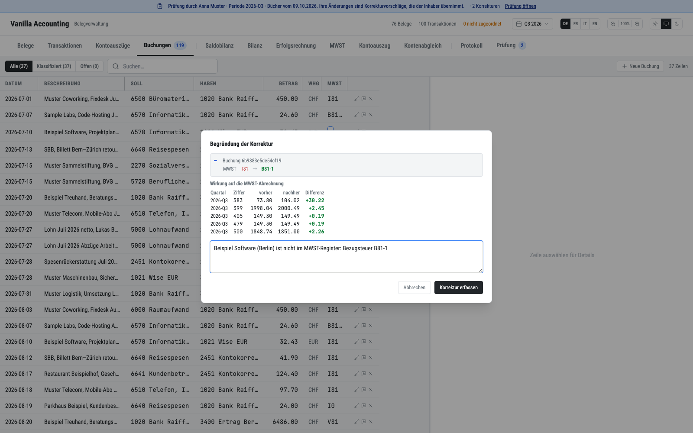
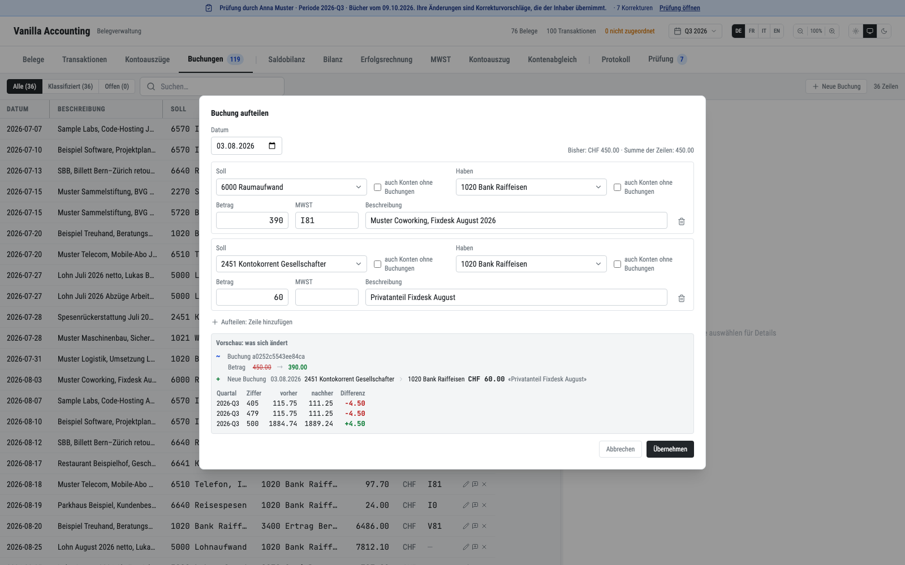
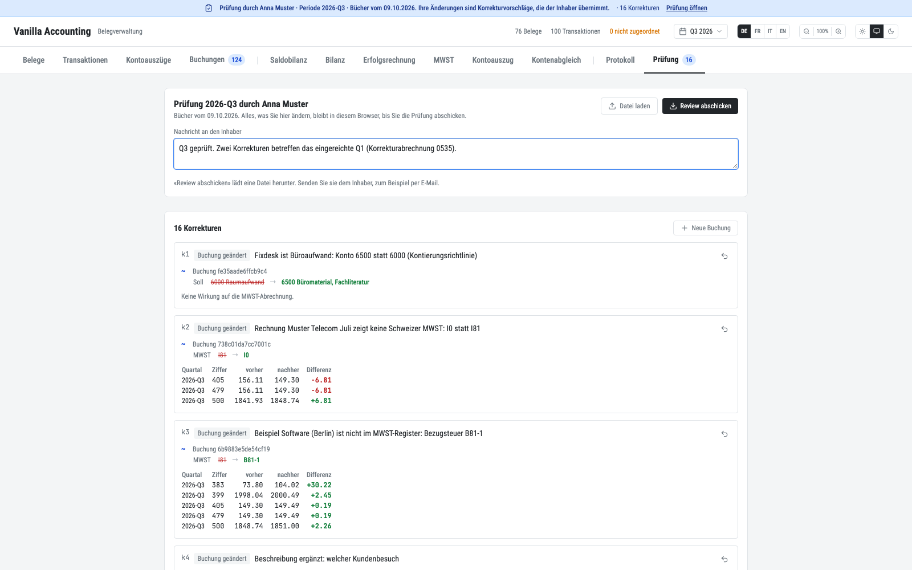
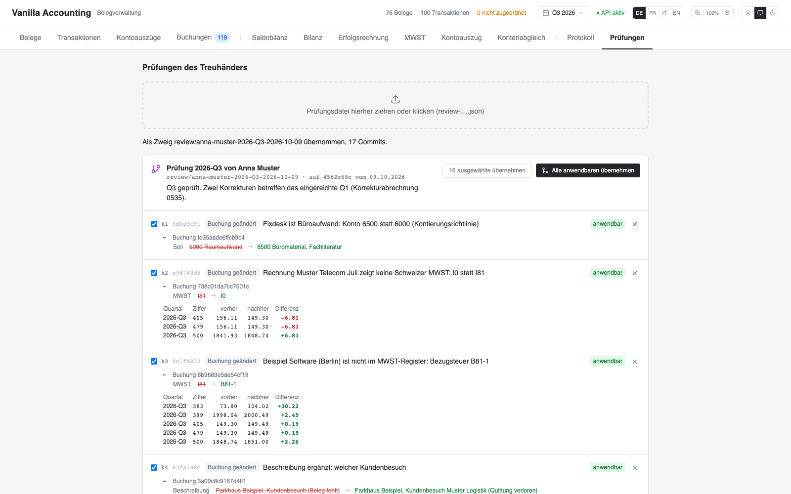

# How to have your books reviewed by your Treuhänder

Your Treuhänder (the accountant who reviews your books) corrects them in a browser, on a copy
you send him. He needs no installation, no login and no programming. His corrections come back
as one file. You import it, and the app shows it the way a programmer sees a pull request: one
commit per correction, with his reason, what it changes, and what it does to each VAT return.
You merge what you accept and reject the rest with a reason. Nothing runs on a server, and
nothing costs anything.

The list of corrections a Treuhänder makes, and which of them the review supports, is in
`docs/accountant-corrections.md`.

## What you need

- Your workspace is a git repository. `npm run init` makes it one. If yours is not, run
  `git init`, then commit `books.json` once.
- Every change to the books is then a git commit by itself: the app commits `books.json` after
  every save, with the writer as author and the action as message. The **Protokoll** tab lists
  these commits.

## For the owner: send the books for review

1. Build the review package. Name the period you want reviewed and the person who reviews it:

   ```sh
   npm run review -- 2026-Q3 --for "Anna Muster" --email anna@example.ch ../review-2026-Q3
   ```

   The command builds the audit export of your books (`docs/audit-export.md`) in review mode,
   and prints the SHA-256 of its `manifest.json`. The package records the git commit it was
   built from, so his corrections later branch from exactly that state.

2. Zip the folder and send it, or put it on web space behind a password. A copy of real books
   on a public URL publishes them.

3. Tell your Treuhänder to open it with `npx serve <folder>` or any static file server, and to
   send you the file that **Review abschicken** downloads.

## For the Treuhänder: review and correct

The blue bar at the top says whose books you review, which period, and how many corrections
you have made. Everything you change stays in your browser until you send it. Closing the tab
loses nothing. Each correction asks for a reason first: the owner reads it as the commit
message.



To correct an entry, use the **Buchungen** tab:

- Double-click Soll, Haben, MWST or the description to change it in place.
- Click the pencil to open the entry form. It changes the date, the amount and the exchange
  rate too. **Aufteilen: Zeile hinzufügen** splits the entry into several lines. The lines must
  sum to the original amount.
- Click **Neue Buchung** for an entry of your own: an accrual, depreciation, a provision, a
  private share. The account search offers every account of the Swiss SME chart under **auch
  Konten ohne Buchungen**.
- Click the cross to delete an entry, or to reverse it when its quarter is filed.

The form shows what changes and the VAT figures it moves, per quarter and Ziffer, before you
save.



A quarter that is already filed with the ESTV never changes. When you edit or delete an entry
of a filed quarter, the package books a reversal (Storno) and, for an edit, the corrected entry,
both dated in the open period and marked «korrigiert 2026-Q1». Their VAT goes to that quarter's
correction return (form 0535), not to the open quarter's return. A receipt link or a
transaction of a filed quarter is refused with the same message the owner's app gives.

To link or unlink a receipt, or to mark a bank transaction «kein Beleg nötig», use the
**Transaktionen** tab as the owner does.

To ask something without changing the books, click the speech bubble on an entry or on a
receipt. **Allgemeiner Kommentar** in the **Prüfung** tab is for the review as a whole.

When you are done, open the **Prüfung** tab:

1. Read your corrections. Each shows its records before and after and its VAT effect. The arrow
   takes a correction back.
2. Sign off the quarter or the year with a statement, for example «Q3 geprüft, kann eingereicht
   werden».
3. Write a message to the owner.
4. Click **Review abschicken**. It downloads `review-2026-Q3-anna-muster.json`. Send that file
   to the owner.



To continue on another computer, open the same package there and load the file with **Datei
laden**. A package of a newer state of the books starts empty, and shows under **Frühere
Prüfungen** what the owner merged or rejected from your earlier reviews, and why.

## For the owner: merge the review

1. Open the **Prüfungen** tab of the app and drop the file on it. On the command line:

   ```sh
   npm run review:import -- ~/Downloads/review-2026-Q3-anna-muster.json
   ```

   The app creates the branch `review/anna-muster-2026-Q3-<date>` from the commit the package
   was built from, with one commit per correction. The author of each commit is the
   Treuhänder, and its message is his reason. A last commit holds his file with the comments
   and sign-offs. Your working tree and your branch do not change. Importing the same file
   again changes nothing.

2. Read the pull request. Each correction shows its commit, its records before and after, the
   VAT figures it moves, and its status against your books as they are today:

   | Status | Meaning |
   | --- | --- |
   | anwendbar | The records are as he saw them. Merging applies his change. |
   | schon so | Your books already look like his result. |
   | Konflikt | You changed the record since the package. It is never applied. Redo it by hand if you agree. |
   | eingereichte Periode | You filed the quarter since the package. Merging books a reversal and the corrected entry with «korrigiert», as the pull request shows. |
   | nicht möglich | It touches a filed quarter and is not an entry, for example a receipt link. |

   

3. Merge or reject. **Alle anwendbaren übernehmen** merges every correction that applies. Untick
   a correction and use **ausgewählte übernehmen** to merge only some. The cross rejects one;
   write why. On the command line:

   ```sh
   npm run review:merge -- review/anna-muster-2026-Q3-2026-10-12 --accept all --reject k4="Text bleibt so"
   ```

The merge applies the corrections to today's books through the same check every write passes
(`mutateJournal`), so a filed quarter cannot change. It is never a git merge of `books.json`.
The app commits the result as a merge commit «Merged review/… by <owner>» with the branch as
second parent, so `git log` keeps every commit of the Treuhänder. An account of the SME chart
that a merged entry uses and your chart lacks is added to `accounts.json`. Your decisions, with
your reasons, are written to `review/<branch>/decisions.json` and shown in the next review
package.

```text
*   5a294df Lukas Beispiel: Merged review/anna-muster-2026-Q3-2026-10-09 by Lukas Beispiel (15 übernommen, 0 abgelehnt)
|\
| * 7fb5a21 Anna Muster: Q3 geprüft. Zwei Korrekturen betreffen das eingereichte Q1 (Korrekturabrechnung 0535).
| * 4849d94 Anna Muster: BVG-Beiträge: Beleg ist die Jahresrechnung der Sammelstiftung
| * …
| * 3d0e3c9 Anna Muster: Fixdesk ist Büroaufwand: Konto 6500 statt 6000 (Kontierungsrichtlinie)
* | 37affd8 Lukas Beispiel: Prüfung review/anna-muster-2026-Q3-2026-10-09: 0 übernommen, 1 abgelehnt
|/
* 4562c68 Lukas Beispiel: Bücher der Muster Consulting GmbH bis 2026-Q3
```

## What the review does not do

- It does not change the chart beyond the SME chart's accounts, the opening balances, or the
  period lock. Closing a quarter stays your act (`npm run seal -- <quarter> --close`).
- It does not call a model. The buttons that would are hidden in the package.
- It does not prove who wrote the file. You vouch for it by merging it.
