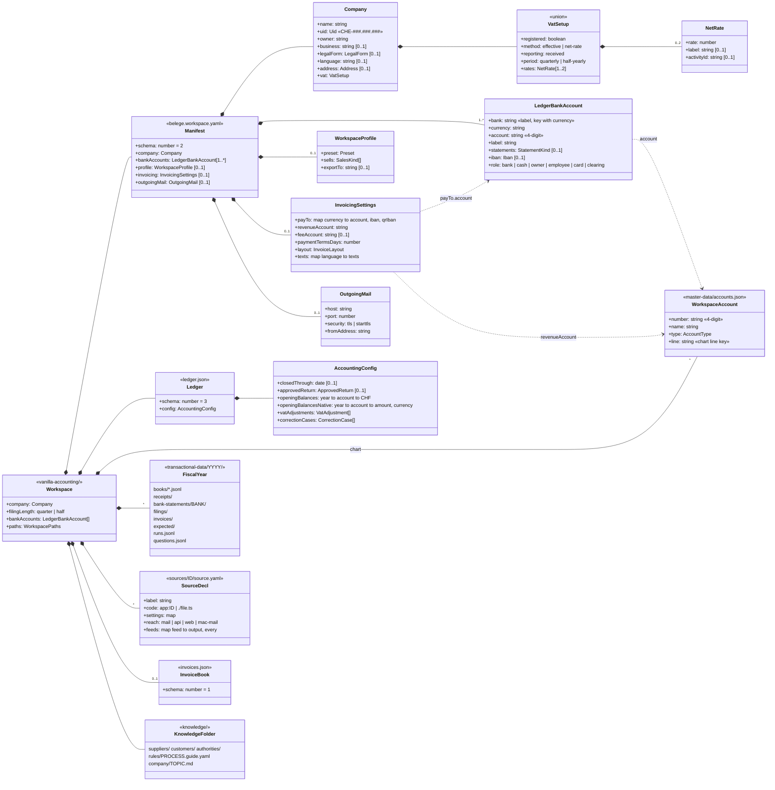
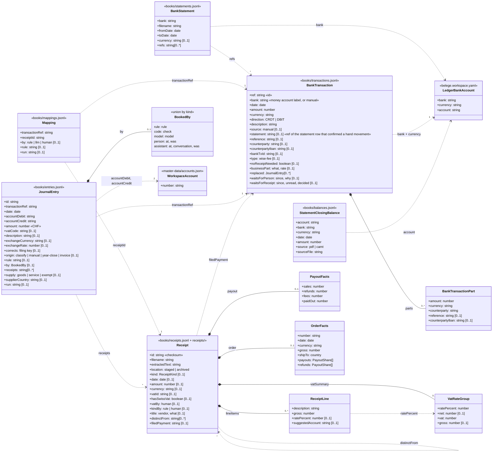
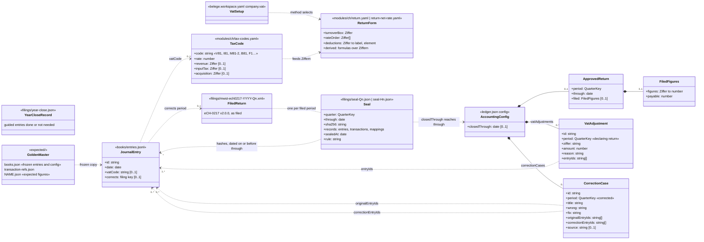
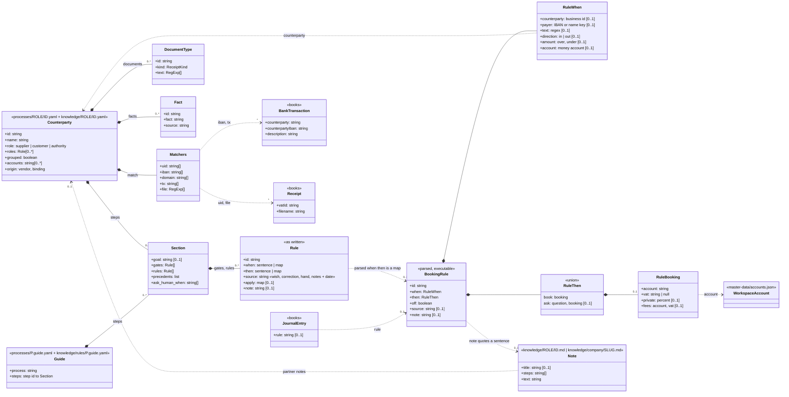
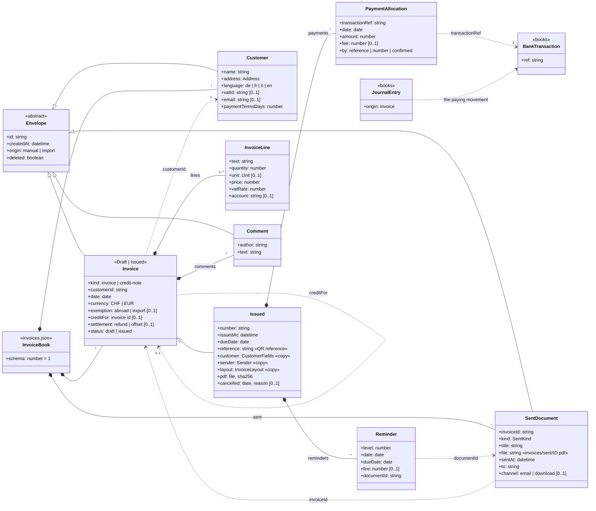
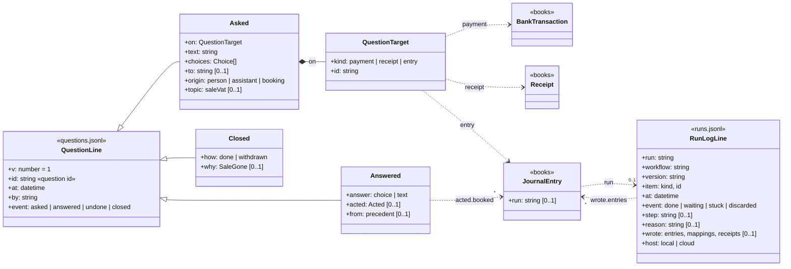

# Data model

Status: describes branch `0.4.0` on 2026-10-23. Derived from the code, not from a plan. When a type
changes, change its diagram here in the same commit.

This page shows what Vanilla Accounting keeps on disk for one company: the classes, their key
attributes, how they refer to each other, and which file each one lives in. It leaves out what the
app only computes (balances, the VAT return's figures, the views of the UI).

The diagrams are UML class diagrams in Mermaid. GitHub renders them. Each class names its file in
`<<…>>`. An association names the field that holds the reference, read in the direction of the
arrow. A dashed arrow is a reference by key (an id, a ref, an account number) that the code resolves.
A diamond is a value nested inside its owner's record.

| Diagram | What it shows |
|---|---|
| [1. Workspace and settings](#1-workspace-and-settings) | The files of a workspace, the manifest, the ledger head, the chart, the sources |
| [2. The books](#2-the-books-movements-receipts-links-entries) | Movements, statements, receipts, links and journal entries |
| [3. VAT and filing](#3-vat-filing-and-the-locked-past) | Tax codes, return forms, approved and filed returns, seals, corrections, the golden master |
| [4. Knowledge and rules](#4-knowledge-and-rules) | Business files, their matchers, guides, executable booking rules, notes |
| [5. Invoices](#5-invoices) | Customers, invoices, payments of an invoice, reminders, sent documents |
| [6. Logs](#6-questions-and-the-run-log) | Questions to people and the run log |

## Schema versions

Every versioned file carries `schema`. The versions and their forward-only migration steps live in
one place, `src/workspace/schema.ts`.

| File | Version now | Migration ladder |
|---|---|---|
| The books (`ledger.json` with `transactional-data/<year>/books/*.jsonl`) | `BOOKS_SCHEMA = 3` (2: books split by fiscal year, ADR 0013; 3: money accounts as equals, #88, no record changes) | `BOOKS_MIGRATIONS` |
| `belege.workspace.yaml` | `WORKSPACE_SCHEMA = 2` (2: each money account names its `role`, #88) | `MANIFEST_MIGRATIONS` (on the YAML document, comments survive) |
| `invoices.json` | `INVOICES_SCHEMA = 1` | `INVOICES_MIGRATIONS` |
| `questions.jsonl` lines | `QUESTION_LINE_VERSION = 1` (`v` on each line) | none |

A file without `schema` is schema 1. A file newer than the app is refused (`SchemaTooNewError`).
`npm run update` writes migrated files back.

## 1. Workspace and settings

A workspace is the folder `vanilla-accounting/` in one company's repository (ADR 0013). `LAYOUT` in
`src/workspace/workspace.ts` is the one list of the names it may hold, each owned either by the app
(the app writes it) or by the company (a person adds it, the app reads it). The manifest
`belege.workspace.yaml` says who the company is, its VAT setup and the ledger account each money
account books on. `ledger.json` holds the books' schema and their config. The chart of accounts is
`master-data/accounts.json`. Everything dated lives under `transactional-data/<year>/`.

Notes on the diagram:

- `VatSetup` is one of three shapes (src/workspace/vat-setup.ts): `{ registered: false }`, the
  effective method, or the net tax rate method with one or two `NetRate`s. A manifest without
  `registered` and `period` means effective and quarterly.
- A money account is found by `bank` and `currency` together, or by `iban` and `currency` when a
  statement names an IBAN. The manifest refuses the same key twice. Every money account names its
  `role` (#88). At most one is the owner's, and the label `manual` must be the owner's account, for
  payments made privately. `statements` is the reader for a statement when one is imported, not a
  mode: any account takes movements by hand and statements alike. The Bilanz places a money account
  by its chart account, never by its role, so the owner's account and a card account stay
  liabilities.
- `AccountType` is `asset`, `liability`, `equity`, `revenue`, `expense` or `closing`
  (src/workspace/chart.ts). `line` names the line of the Bilanz or Erfolgsrechnung the account is
  shown on.
- No password lives in the workspace. Mail and source secrets go to the keychain or `.env`.
- Top-level names not drawn: `mail.yaml`, `secret-terms.txt`, `modules/`, `workflows/`,
  `beleg-import/` (the inbox), `history/`, `collected/`, `onboarding.json`, `logos/`, `data/`
  (generated copies, not in git), `VERSION`.

## 2. The books: movements, receipts, links, entries

The books are `ledger.json` plus, per fiscal year, six JSON Lines files in
`transactional-data/<year>/books/` (`BOOK_FILES` in src/books/years.ts), one record per line, sorted
by id. `loadBooks` and `saveBooks` in src/books/store.ts are the only door. In memory they form one
`Index`.

A bank movement (`BankTransaction`) moved on one money account. A receipt is linked to a movement
by a `Mapping`. A journal entry books a movement through `transactionRef`. A receipt's VAT facts are
read off the document, and the classifier decides the entry's VAT code from them.

Notes on the diagram:

- Multiplicities between the main records: a movement has 0..* entries (a split booking writes
  several with the same `transactionRef`) and 0..* mappings. A receipt has 0..* mappings: a grouped
  charge (several invoices in one payment) links many receipts to one movement, and a receipt is
  normally linked to one movement.
- A booking without a payment (#89) carries a ref of its own in `transactionRef`, and its receipts
  in `receipts`. A `Mapping` may name that ref too: a receipt linked to a booking without a payment.
- A hand movement confirmed by a statement row (#88) keeps its own `ref`; `statement` holds the
  row's ref, and `BankStatement.refs` lists the row's ref, not the movement's.
- A Sammelzahlung stays one `BankTransaction`. Its `parts` are what receipts match against and what
  entries split by.
- `amount` of an entry is in CHF. A foreign movement carries `exchangeCurrency` and the ESTV daily
  sell rate of the payment date in `exchangeRate` (ADR 0001).
- `origin: manual` and `by.kind: person` mark a person's entry. Only a person may change or remove
  it (the write door `update` in src/books/store.ts).
- Each record lies in the year file of its date. Records dated on or before
  `config.closedThrough` are frozen and sealed (diagram 3).

## 3. VAT, filing and the locked past

The VAT engine reads codes and return forms from the jurisdiction module (`modules/ch/`), not from
the books. An entry's `vatCode` names a code of `tax-codes.yaml`. The return form maps codes to
boxes (Ziffern). The form is `return.yaml` (form 0550, effective method) or `return-net-rate.yaml`
(form 0553, net tax rate method), chosen by `company.vat`.

A filing period is a quarter (`2026-Q2`) or a half year (`2026-H1`). Approving a return holds the
books (`approvedReturn`). Filing it moves `closedThrough` and writes a seal. A filed period never
changes again (golden rule 1): a correction is a new entry in the open period with `corrects`, and
the 0535 Korrekturabrechnung recomputes the filed period from today's books.

Notes on the diagram:

- A code carries a rate. The letter is the kind (V sale, I operating expense or investment, M
  material, B Bezugsteuer, F net tax rate). A leading `-` reverses it for a refund. The suffix `-1`
  means the amount is net, `-2` that it is the tax itself. See docs/vat-codes.md.
- A seal hashes the canonical JSON of every journal entry, bank transaction and receipt mapping dated
  on or before `through` (src/books/seal.ts). `loadBooks` checks every seal. Books whose sealed part
  changed load read-only.
- Every entry with `corrects` belongs to exactly one `CorrectionCase`.
- A `VatAdjustment` is only for a VAT event of the open period that refers to a filed entry. It is
  never dated into a filed period.
- Opening balances (`config.openingBalances`) enter no return and no seal.
- `expected/` holds the golden master that `npm run test:books` compares the books against. The
  demo workspaces keep theirs in `tests/golden/<demo>/`.

## 4. Knowledge and rules

Knowledge has two layers. The app layer ships `processes/` (flows, guides and one file per business
that holds for any company). The workspace layer is `knowledge/` in the company's workspace (its
accounts, rules and precedents per business, and its private businesses). A business's two files
are merged into one `Counterparty` (src/knowledge/counterparties.ts). The folder of the file is the
business's main role.

A business owns movements and receipts through its `match` signals, tried strongest first: `uid` (on
a linked receipt), `iban` (the other party on the statement), `domain` (the sender at collection),
`tx` (a part of the bank's counterparty name or of the merchant in the text), `file` (a pattern over
the archived filename). The first tier with exactly one hit decides.

A rule is executable when its `then` is a map (`BookingRule`, src/booking/rules.ts). It stands in
the step `classify` of `knowledge/rules/booking.guide.yaml`, or in a business's file under
`steps: booking.guide.yaml#classify`, where it needs no `when` of its own. A rule whose `when` and
`then` are sentences is a note for people and the AI, and nothing carries it out.

Notes on the diagram:

- A shipped business file (`processes/`) holds facts true for every company. It never assumes a VAT
  rate for a receipt that cannot be read. Accounts and company rules go into the workspace file.
- `RuleWhen` conditions must all hold. `private` and `fees` exclude each other, and `fees` goes with
  no `ask`.
- `Rule.apply` carries what code does for a business beyond booking (for example
  `apply: { receipt: none }` on `evidence.guide.yaml#rules`, src/booking/purchase-vat.ts).
- Firma › Regeln counts how often each rule booked from `JournalEntry.rule` and how often it asked
  from the questions (diagram 6).

## 5. Invoices

`invoices.json` holds the customers, the invoices and the documents sent (src/invoices/model.ts).
An issued invoice is frozen with copies of its customer, sender and layout, and its PDF lies in
`transactional-data/<year>/invoices/<number>.pdf`. A payment of an invoice is an allocation of a bank
movement. The paid revenue is booked as journal entries with `origin: invoice`.

A firm that is not registered for VAT issues invoices without VAT: its only rate is 0.

## 6. Questions and the run log

Two append-only logs per fiscal year record what happened around the books. `questions.jsonl` holds
the questions between the people who keep the books, one event per line; a question's state is the
fold of its lines (src/questions/model.ts). `runs.jsonl` holds one line per workflow run that wrote,
waited for a person, got stuck or was discarded (src/workflows/runlog.ts). Entries, mappings and
receipts name their run in `run`.

## Sources in the code

| What | Where |
|---|---|
| Books records (`Index`, `JournalEntry`, `BankTransaction`, `Receipt`, `Mapping`, config) | src/types/index.ts |
| Books on disk, the write door, period lock | src/books/store.ts, src/books/years.ts |
| Seals | src/books/seal.ts |
| The referential integrity check: keys that name no record (`npm run doctor`) | src/accounting/integrity.ts |
| Workspace layout and paths | src/workspace/workspace.ts (`LAYOUT`) |
| Manifest | src/workspace/manifest.ts, src/workspace/vat-setup.ts |
| Schema versions | src/workspace/schema.ts |
| Chart of accounts | src/workspace/chart.ts |
| Business files, matchers, guides, notes | src/knowledge/counterparties.ts, src/knowledge/layers.ts, src/knowledge/notes.ts |
| Booking rules | src/booking/rules.ts |
| Invoices | src/invoices/model.ts |
| Questions, run log | src/questions/model.ts, src/workflows/runlog.ts |
| Sources | src/platform/sources/load.ts |
| Tax codes and return forms | modules/ch/tax-codes.yaml, modules/ch/return.yaml, modules/ch/return-net-rate.yaml |
