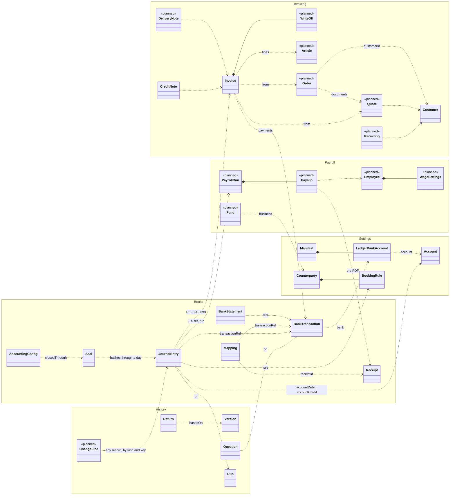
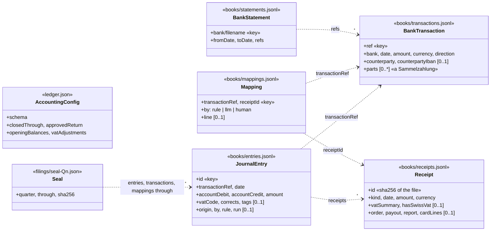
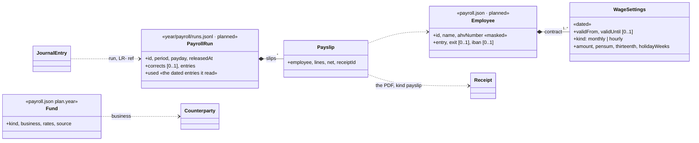
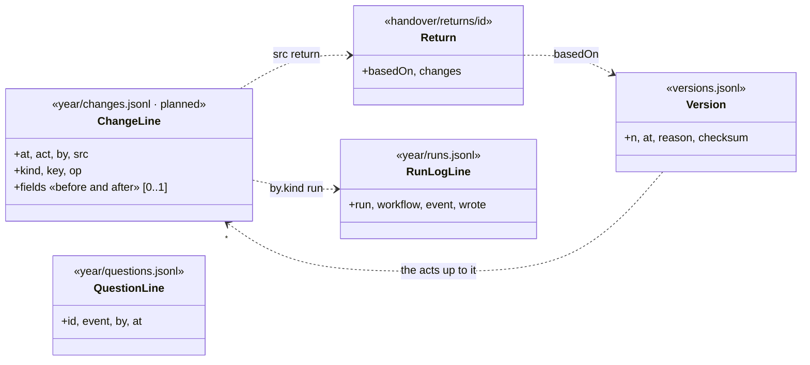

# Spec: the whole domain model, and how changes are stored

Status: draft for the owner, 2026-11-15, with section 7 (values that change over time) and
section 8 (BaseObject, approved by the owner) added the same day. No code yet. Judged by [MISSION.md](../../MISSION.md),
[ADR 0004](../adr/0004-versions-and-record-envelope.md) (versions and the record envelope),
[ADR 0013](../adr/0013-workspace-layout-and-ownership.md) (workspace layout),
[ADR 0015](../adr/0015-base-cases-in-the-app-long-tail-in-the-workspace.md) (app and workspace)
and the owner's rules: warn, don't block (a change is recorded like any action, with no override
flag); compliant, not stricter; base cases in the app, the long tail in the workspace.

The owner asked on 2026-11-15: «can you also start designing the whole data model. where do we
store the whole domain model? and how do we store modifications to that domain model?»

The question has two meanings, and both are answered here:

- **The definition.** Where the entities, fields, relations and rules are written down as one
  source of truth, and how a change of that definition is versioned and migrated (sections 4
  and 5).
- **The data.** How a change of the data (a booking, a receipt, an invoice, a payslip) is stored
  and kept traceable (section 6).

Sections 1 to 3 are the model itself: what exists, what the invoicing and payroll specs add, and
one picture of the whole. Section 7 adds the owner's question of the same day: how a setting that
changes over time is kept. Section 8 sets the base every stored object shares.

## Summary

| Question | Recommendation |
|---|---|
| Where the definition lives | The TypeScript types stay the source. A registry names every stored file with its root type, version, ladder and owner. A generator writes a JSON Schema per file and the diagrams of [docs/data-model.md](../data-model.md); a test fails when they drift. |
| How definition changes are stored | Per-file versions for the files' layout, and a version per record type (section 8), each with a forward-only ladder, all in the one registry. A fixed rule says when a change needs a step. Every step gets a fixture test, generated from one pattern. |
| How data changes are stored | State files stay the truth, and git stays the history and the transport. Add an append-only change log per year (`changes.jsonl`, «Änderungsprotokoll»), written by the write door: who, when, which record, the fields before and after. No event sourcing. |
| The base of every record | `BaseObjectV1`: `id`, and optional `createdAt`/`createdBy`, `lastChangedAt`/`lastChangedBy`, `rev`, `origin`, `externalId`, `deleted`, `customFields`. A version per type (`InvoiceV3`; on disk `"type"`, `"v"`), each with its own ladder; the share service and the API translate. Sealed records keep their shape (section 8). |
| Values that change over time | Every setting a document or run reads for its day is a dated history (`Dated<T>`: `validFrom`, optional `validUntil`, never overwritten), stored inline in its file. Documents and runs read on their own date and keep what they used. A change dated in the past warns and offers the ways on; the person decides (section 7). |

## 1. Inventory: what the app stores today

Every row is a file or a family of files the app reads. «Writes» names who changes it, through
which door. «Person» is a person in the UI or a command she runs (`PERSON`, actor kind `person`);
«AI» is the sidebar acting on her wish, which writes as the person and marks its bookings
`by.kind: 'assistant'`; «module» is code that writes on its own (`moduleActor(id)`); «run» is a
workflow run (actor kind `run`). Paths are relative to the workspace `vanilla-accounting/`.

### 1.1 The books

One `Index` in memory (`Books`, src/books/store.ts). `loadBooks` and `saveBooks` are the only door,
and every change goes through `update(books, actor, fn)`. One version for all of them:
`BOOKS_SCHEMA = 9`, ladder `BOOKS_MIGRATIONS` (src/workspace/schema.ts).

| Entity (code / UI) | File | Owner module | Writes |
|---|---|---|---|
| `JournalEntry` / Buchung | `transactional-data/<year>/books/entries.jsonl` | src/books/store.ts | module (classify, invoicing, year-close, sales-report), run, person, AI |
| `BankTransaction` / Zahlung, Bewegung | `…/books/transactions.jsonl` | src/books/store.ts | module (statement import), person (hand movement) |
| `Mapping` / Verknüpfung (receipt ↔ payment, or ↔ a booking's own ref; `line` for a card line) | `…/books/mappings.jsonl` | src/books/store.ts | module (match), run, person |
| `Receipt` / Beleg (with `OrderFacts`, `PayoutFacts`, `SalesReportFacts`, `CardLine`s, VAT facts) | `…/books/receipts.jsonl`; the file in `…/receipts/` | src/books/store.ts, src/intake/ | module (intake), run, person |
| `BankStatement` / Kontoauszug | `…/books/statements.jsonl`; the file in `…/bank-statements/<bank>/` | src/books/store.ts | module (import) |
| `StatementClosingBalance` / Saldo | `…/books/balances.jsonl` | src/books/store.ts | module (import) |
| `StatementAsk` (a PDF waiting for «Einlesen») | `…/books/asks.jsonl` | src/books/reconcile.ts | module, person |
| `Reconciliation` / Abstimmung | `…/books/reconcile.jsonl` | src/books/reconcile.ts | module, person |
| `AccountingConfig`: `closedThrough`, `approvedReturn`, `openingBalances`, `vatAdjustments`, … | `ledger.json` (with `schema`) | src/books/store.ts | person (filing, Firma › Eröffnung, Firma › MWST), module (year-close) |
| `Seal` / Siegel | `transactional-data/<year>/filings/seal-<Qn>.json` | src/books/seal.ts | person (`npm run seal`, the filing step); never rewritten |
| Filed returns (XML, PDF as filed) | `…/filings/` | src/workflows/filing.ts | person; never regenerated |
| Golden master of the books | `…/expected/` | tests/support/golden.ts | person (`npm run test:books:update`) |

Records of a year lie in the year of their date (src/books/years.ts). Records dated on or before
`closedThrough` are frozen and sealed.

### 1.2 Settings and master data

| Entity (code / UI) | File | Owner module | Version | Writes |
|---|---|---|---|---|
| `Manifest`: `Company`, `VatSetup`, `LedgerBankAccount`s, `Dimension`s, `InvoicingSettings`, `OutgoingMail`, `WorkspaceProfile` / Firma | `belege.workspace.yaml` | src/workspace/manifest.ts | `WORKSPACE_SCHEMA = 4`, `MANIFEST_MIGRATIONS` (on the YAML document) | person (Firma, `npm run init`), AI (draft, kept on a card) |
| Chart of accounts / Kontenplan | `master-data/accounts.json` | src/workspace/chart.ts | none | person, module (setup) |
| Mailboxes and sender sorting | `mail.yaml` | src/collect/mail-config.ts | none | person, AI |
| Sources (ADR 0014) / Quellen | `sources/` | src/platform/sources/load.ts | none | AI with the person |
| What a source delivered (dedup ledger) | `collected/<source>.jsonl` | src/platform/sources/ledger.ts | none | module (collect) |
| Secret terms for the leak guard | `secret-terms.txt` | src/publish/leak-guard.ts | none | person |
| Setup checklist / Einrichtung | `onboarding.json` | src/onboarding/store.ts | `SCHEMA = 1`, local, no ladder | module, person |
| Workspace overlays of modules and workflows | `modules/`, `workflows/` | src/core/modules/load.ts, src/workflows/ | the module's own version | AI with the person |

Each setting here is one current value, and a change overwrites it. Section 7 turns those a
document or run reads for its day into dated histories.

### 1.3 Knowledge

| Entity (code / UI) | File | Owner module | Version | Writes |
|---|---|---|---|---|
| `Counterparty` / Geschäftspartner (match signals, accounts, `provider:`, steps) | `processes/{suppliers,customers,authorities}/<id>.yaml` (app) + `knowledge/{…}/<id>.yaml` (company), merged | src/knowledge/counterparties.ts, layers.ts | none | app layer: maintainers; company layer: AI drafts, person keeps on a card |
| `BookingRule` / Regel (`when`, `then`) | `knowledge/rules/booking.guide.yaml#classify`, or a business's file | src/booking/rules.ts | none (refused when not executable) | AI or the hand form (src/saving/hand-rule.ts), person keeps |
| Guides and precedents per step | `processes/*.guide.yaml` + `knowledge/rules/*.guide.yaml` | src/knowledge/layers.ts | none | AI, person |
| Flows | `processes/*.flow.yaml` | src/workflows/ | none | maintainers |
| Notes / Notizen | the business's file | src/knowledge/notes.ts | none | person, AI |
| Tax codes, return forms, accounts, setup answers (law data) | `modules/ch/*.yaml` | src/core/modules/schema.ts, src/engines/ | `module.yaml` version (CalVer) | maintainers; a workspace overlay may replace an entry |

### 1.4 Invoicing

`invoices.json`, owner src/invoices/store.ts, `INVOICES_SCHEMA = 2`, ladder `INVOICES_MIGRATIONS`.
Records carry the ADR 0004 envelope (`id`, `createdAt`, `origin`, `deleted`).

| Entity (code / UI) | Where | Writes |
|---|---|---|
| `Customer` / Kunde | `invoices.json` `customers` | person, AI (draft) |
| `Draft`, `Issued` (an invoice or a credit note) / Rechnung, Gutschrift; with `InvoiceLine`s, `PaymentAllocation`s, `Reminder`s / Mahnungen, `Comment`s | `invoices.json` `invoices`; the PDF in `transactional-data/<year>/invoices/<number>.pdf` | person (only a person issues), module (invoicing: payments) |
| `SentDocument` / Versand | `invoices.json` `sent` | module, on a person's send |
| Logos | `logos/logo-<checksum>.<ext>` | person |
| Bookings of an invoice (`RE-…`, `GS-…`, `RE-…-storno`) | the books, `origin: 'invoice'` | module (invoicing) |

### 1.5 Logs and hand-over

| Entity (code / UI) | File | Owner module | Version | Writes |
|---|---|---|---|---|
| `QuestionLine` / Frage (asked, answered, undone, closed) | `transactional-data/<year>/questions.jsonl` | src/questions/ | `QUESTION_LINE_VERSION = 1` per line, no ladder | person, module, run, AI |
| `RunLogLine` / Lauf | `transactional-data/<year>/runs.jsonl` | src/workflows/runlog.ts | none | run |
| `Version` / Version («Version 12») | `versions.jsonl` | src/handover/versions.ts | `VERSIONS_SCHEMA = 1` (header line) | module, on a hand-over, a take-over, a seal |
| A return from the fiduciary / Rücksendung (the package and her decisions) | `handover/returns/<id>/` | src/handover/returns.ts | `PACKAGE_FORMAT = 1` | module on receipt, person on take-over |
| A package or share | encrypted at the share service, or a `.vanilla` file | src/handover/package.ts, src/share/ | `PACKAGE_FORMAT = 1`, `FORMAT_VERSION = 1` | module, on a person's share |
| Deleted bookings since the last save | `data/trash/entries/<id>.json` (not in git) | src/saving/changes.ts | none | module, on a person's delete |
| A prepared save | `data/saving/proposal.json` (not in git) | src/saving/saving.ts | none | module |

### 1.6 Outside the workspace

| What | Where | Why outside |
|---|---|---|
| Passwords, API keys, share keys, signing keys | the keychain or the desktop's sealed store (src/secrets/); `.env` as fallback | the workspace is a folder people share and commit |
| `DesktopState` (recent books, window, phone pairing; planned: this Mac's `person`) | `desktop.json` in the desktop's user data folder (src/desktop/state.ts) | belongs to the device, not the books |
| Reference data (ESTV daily rates, charts) | `reference/` of the app | public, the same for every company |

### 1.7 Reserved but not built

- `VERSION` at the top (LAYOUT, owner `app`): ADR 0004's one workspace version. Nothing writes it.
- `access.yaml` (people and roles, e2e spec Q-B1): planned, not built.

## 2. Planned entities

### 2.1 Invoicing (docs/specs/invoicing.md on `spec/invoicing`, decided 2026-11-14)

All in `invoices.json`, one `INVOICES_SCHEMA` step per phase (3 in phase 1, then one each in
phases 2 and 3), settings in the manifest's `invoicing:` (one `WORKSPACE_SCHEMA` step in phase 1).

| Entity (code / UI) | Shape | Booked |
|---|---|---|
| Quote / Offerte | `kind: 'quote'`, series `OF-YYYY-NNN`, `validUntil`, `status` draft → sent → accepted / declined / expired | nothing |
| Order confirmation / Auftragsbestätigung | the accepted quote sent again with that title; no record of its own | nothing |
| Delivery note / Lieferschein | `kind: 'delivery-note'`, series `LS-…`, no prices on paper | nothing |
| Invoice / Rechnung | gains `from: { id, kind }` (the quote or order), `ordered` (the customer's reference), `role: 'partial' \| 'final'`, `schedule` (instalments, retention), `offsets` (credit notes set off), `paidAtIssue` (Quittung) | as today; on the agreed basis `RE-<n>` |
| Credit note / Gutschrift | as today; set off as a deduction line (`InvoiceLine.deducts`) on the next invoice | as today |
| Write-off / Abschreibung, Skonto, Debitorenverlust | `writeOffs: [{ date, amount, reason, note }]` on an issued invoice | cash basis: nothing; agreed: `RE-<n>-wo-<k>` |
| Recurring invoice / Abo | `recurring: [Envelope & { customerId, template, every, next, until, issue }]` | as each invoice it makes |
| Article / Artikel | `articles: [Envelope & { number, text, unit, price: Dated, vatRate, account }]` | nothing |
| Line kinds | `InvoiceLine.kind` title, subtotal, text; `discount`, `articleId`, `activity`, `tags`, `source` | as the invoice |

### 2.2 Payroll (docs/specs/payroll.md on `spec/payroll`, decided 2026-11-14)

| Entity (code / UI) | File | Version |
|---|---|---|
| Payslip from outside / Lohnabrechnung (level A) | a `Receipt` of kind `payslip`; its figures derived on every read, not stored | `BOOKS_SCHEMA` 10 for `by.check: 'payslip' \| 'payrollJournal' \| 'payroll'` (one step) |
| Employee / Mitarbeiterin (name, AHV number, birth date, entry, exit, IBAN, language) | `payroll.json` `employees` | new `PAYROLL_SCHEMA = 1` |
| Wage settings / Lohnvereinbarung (dated contract entries: monthly or hourly, pensum, 13th salary, holidays; pension per employee; allowances; tax at source) | `payroll.json` `employees[].contract`, `pension`, `allowances`, `taxAtSource`, each `Dated` (section 7) | same |
| Funds and the firm's rates / Kassen und Sätze (canton, AHV fund, pension, accident, sickness, each entry with its source document) | `payroll.json` `plan`, each rate set `Dated` (section 7) | same |
| Payroll run / Lohnlauf, with its payslips and lines `{ kind, base, rate, amount, party, source }` | `transactional-data/<year>/payroll/runs.jsonl`, one released run per line, immutable; a correction is a new run with `corrects` | same |
| Payslip PDF of a run | a `Receipt` of kind `payslip` in `…/receipts/`, linked to the run | books |
| Bookings of a run | `LR-<yyyy>-<mm>-<employee>`, `by: { kind: 'code', check: 'payroll' }`, `run` | books |
| Federal rates and Lohnausweis fields | `modules/ch/payroll.yaml`, `modules/ch/payroll/<year>.yaml` | the module's version |

### 2.3 Orders from outside / Bestellung (new, design only)

An order is a customer's wish to buy, from outside the app: a form on the firm's website, a shop,
an e-mail a source turns into data. It is not a tax event: it books nothing. It leads to a
document the person sends (an order confirmation, a delivery note, an invoice), or it is the sale
of a payment provider that the provider's report books already.

```ts
interface Order extends Envelope {        // id, createdAt, origin: 'import' | 'manual', deleted
  source: string;                         // the source that delivered it (sources/<id>, ADR 0014)
  external: string;                       // its id at the source; (source, external) is unique
  date: string;                           // the order's date as the source states it
  customer: { name: string; email?: string; address?: Address; uid?: string; language?: string;
              customerId?: string };      // set once matched to a Customer, by code or by the person
  lines: Array<{ text: string; quantity: number; unit?: string; price: number; vatRate?: number;
                 vatIncluded?: boolean; articleId?: string; sku?: string }>;
  currency: string;
  total: number;                          // as the source states it; code checks it against the lines
  paid?: { provider: string; ref?: string; at: string };   // paid at the source (a provider's file id)
  status: 'received' | 'accepted' | 'declined' | 'done' | 'cancelled';
  documents?: string[];                   // the quote, delivery note or invoice ids made from it
  file: string;                           // the delivered file, kept beside the records
}
```

**Where it lands.** A source or a drop delivers one file per order into `beleg-import/`, in a
small versioned upload shape (`{"v":1,"kind":"order",…}`, like the receipt upload format). The
intake reads it, finds an earlier one by `(source, external)` and so never takes an order twice,
and writes the record to `transactional-data/<year>/orders/orders.jsonl` (year of `date`), the file
beside it. A new store with its own `ORDERS_SCHEMA = 1`; LAYOUT's year gains `orders`. Not
`invoices.json`: a shop has thousands of orders a year, and they belong to a year.

**What follows, by code first.** The customer is matched by e-mail or UID, or proposed as a new
`Customer`. An order with `paid` by a provider whose file has `reports.sales` is that provider's
sale: it links to the order page or the report row by its number and nothing more happens (no
second booking). Any other order proposes an order confirmation or an invoice draft; a person
issues it (invoicing decision 7.4). Only base cases in the app: a website's own fields are mapped
in the workspace's source, never in app code (ADR 0015).

`OrderFacts` on a receipt stays what it is: the facts read off a provider's order page. An `Order`
and an order page with the same number refer to the same sale.

## 3. The whole model

### 3.1 Glossary

The code name is English, the UI name German. One name per thing, in code, docs and UI.

| Code | UI (de) | What it is |
|---|---|---|
| Workspace | Buchhaltung, Bücher | One company's `vanilla-accounting/` folder |
| Manifest | Firma | Who the company is, its VAT setup, money accounts, settings |
| LedgerBankAccount | Geldkonto | A ledger account money moves through (bank, card, cash, owner) |
| Account (chart) | Konto, Kontenplan | An account of `master-data/accounts.json` |
| BankTransaction | Zahlung, Bewegung | One movement on one money account |
| BankStatement | Kontoauszug | A statement file and the movements it confirmed |
| StatementClosingBalance | Saldo | A balance a statement states |
| Reconciliation | Abstimmung | Read movements set against a bank export |
| Receipt | Beleg | A document: invoice, sales record, supporting, statement, payslip |
| Mapping | Verknüpfung | A receipt linked to a payment or to a booking |
| JournalEntry | Buchung | One debit/credit line, with its VAT code |
| AccountingConfig | – | `ledger.json`: the books' head |
| closedThrough | eingereicht bis | The line of the filed periods |
| Seal | Siegel | The hash of everything filed through a day |
| VatAdjustment | MWST-Korrektur | A VAT event of the open period on a filed entry |
| Counterparty | Geschäftspartner | A business with a file of its own |
| BookingRule | Regel | `when` → `then`, carried out by code |
| Question | Frage | A question between the people who keep the books |
| Run | Lauf | One workflow run over one item |
| Customer | Kunde | Who an invoice goes to |
| Invoice, CreditNote | Rechnung, Gutschrift | A document that asks for or returns money |
| Quote | Offerte | A price offered, before an order |
| DeliveryNote | Lieferschein | What was delivered, no prices |
| Reminder | Mahnung | A reminder of an overdue invoice |
| WriteOff | Abschreibung | What will not be paid: Skonto, discount, loss |
| Recurring | Abo | An invoice made again every period |
| Article | Artikel | A priced item to put on a line |
| Order | Bestellung | A customer's order from outside |
| Employee | Mitarbeiterin, Mitarbeiter | A person on the payroll, the owner included |
| WageSettings | Lohnvereinbarung | An employee's contract lines from a date |
| Fund | Kasse | AHV, pension, accident, sickness insurer, with the firm's rates |
| PayrollRun | Lohnlauf | One month's released payroll |
| Payslip | Lohnabrechnung | One employee's lines of a run, and its PDF |
| Version | Version | A named state of the books (hand-over, take-over, seal) |
| Return | Rücksendung | A fiduciary's changes, sent back |
| ChangeLine (new) | Änderung, Änderungsprotokoll | One record changed by one action (section 6) |
| Dated (new) | gilt ab, Verlauf | A setting's values, each with the days it holds (section 7) |
| BaseObject (new) | – | The fields every stored record shares: id, who and when, `rev`, origin, external id, deleted, custom fields (section 8) |
| CustomField (new) | Eigenes Feld | A field a company defines for its records (section 8.3) |

### 3.2 The whole model in one picture

Only entities and their main references. The fields are in the per-area diagrams and in
[docs/data-model.md](../data-model.md). A dashed arrow is a reference by key. Planned entities are
marked `<<planned>>`.



### 3.3 The books



### 3.4 Invoicing and orders

```mermaid
classDiagram
  direction LR
  class Order {
    <<year/orders/orders.jsonl · planned>>
    +source, external «unique»
    +customer, lines, total, currency
    +paid [0..1], status
  }
  class Quote {
    <<invoices.json · planned>>
    +number «OF-YYYY-NNN»
    +validUntil, status
  }
  class Invoice {
    <<invoices.json>>
    +number «YYYY-NNN»
    +from [0..1], role [0..1]
    +schedule, offsets [0..*]
  }
  class DeliveryNote {
    <<invoices.json · planned>>
    +number «LS-…»
  }
  class CreditNote {
    <<invoices.json>>
    +number «YYYY-NNN»
  }
  class WriteOff {
    +date, amount, reason
  }
  class Customer {
    <<invoices.json>>
    +number [0..1], address, uid, language
  }
  class Recurring {
    <<invoices.json · planned>>
    +template, every, next
  }
  Order ..> Customer : customerId
  Order ..> "*" Quote : documents
  Quote ..> Customer
  Invoice ..> Quote : from «accepted: Auftragsbestätigung»
  Invoice ..> Order : from
  DeliveryNote ..> Invoice
  CreditNote ..> Invoice : credits or offsets
  Invoice *-- "*" WriteOff
  Recurring ..> Customer
  Recurring ..> "*" Invoice : makes
```

### 3.5 Payroll



### 3.6 History



## 4. Where the definition lives

### 4.1 Today

The definition is spread over five places, and they drift:

- **TypeScript types**: src/types/index.ts (the books), src/invoices/model.ts, src/workspace/workspace.ts
  and manifest.ts, src/questions/model.ts, src/handover/, src/core/modules/schema.ts (law data).
  This is what the code obeys. The TSDoc comments hold most of the rules.
- **src/workspace/schema.ts**: three versions and their ladders; each step's comment says why an
  older app must refuse. `onboarding.json`, `questions.jsonl`, `versions.jsonl` and the package
  keep their versions elsewhere, without a ladder.
- **docs/data-model.md**: Mermaid diagrams written by hand. It says «describes branch 0.4.0 on
  2026-10-23» and has drifted: it shows the manifest at `schema = 3` (the code is at 4) and
  `invoices.json` at 1 (the code is at 2).
- **ADRs and specs**: why a shape is as it is.
- **Hand-written parsers**: `parseManifest`, `parseCustomer`, the books' loaders. They check at the
  boundary, with German messages.

Knowledge files (YAML the AI writes) have no version and no schema at all. Their shape is checked
by the code that reads them (src/booking/rules.ts refuses a rule it cannot carry out).

### 4.2 Options

| | A. TypeScript types are the source | B. A model file is the source | C. A runtime schema library is the source |
|---|---|---|---|
| What | The types stay as they are. A registry names each stored file and its root type. A generator writes a JSON Schema per file and the diagrams. | `model/*.yaml` (entities, fields, relations), like the modules' data. A generator writes the TS types, JSON Schemas and diagrams. | Each type is written as a schema (zod or valibot); the TS type is inferred, JSON Schema derived. |
| Rewrite | none: a registry and tags on reference fields | every type, about 3000 lines | every type, and every parser |
| Inner loop | edit a type, run the test | edit YAML, regenerate, then code | edit a schema |
| Validation on load | the hand parsers, as today; optionally JSON Schema in `npm run doctor` | generated | free, at every boundary |
| Comments and rules | stay in TSDoc next to the field | must move into YAML or get lost | stay, but schema code reads worse than types |
| Other readers (the iOS app, an auditor, a fiduciary's tool, the AI) | the generated JSON Schema | the YAML and JSON Schema | the derived JSON Schema |
| New dependency | a dev dependency (`ts-json-schema-generator`) or the TypeScript compiler API, which is there already | a code generator | a runtime library, in the browser bundle too |
| Risk | the generator does not understand an exotic type; fixed with a simpler type | two truths while porting; codegen breaks the build | a large migration for a benefit the parsers already give |

### 4.3 Recommendation: A, with one registry and a drift test

- **The types are the definition.** A field is defined once, in TypeScript, with its rule in TSDoc.
  No second hand-written copy of a field.
- **One registry of stores** (`STORES`, src/workspace/schema.ts, which already calls itself «the
  one place the versions are listed»). Per stored file: its LAYOUT name or pattern, the root type,
  the version constant, the ladder, the owner module and who writes it. Section 1's tables are the
  first content.
- **References are tagged** in the type: `/** @ref Receipt.id */ receiptId: string`. The diagram
  draws a dashed arrow from it. `src/accounting/integrity.ts` checks the same references today; it
  can later read the tags instead of its own list.
- **`npm run model`** (tools/model/) writes `docs/model/<store>.schema.json` (JSON Schema 2020-12,
  its `$id` naming the store and its version) and rewrites the diagrams of docs/data-model.md
  between generated markers. The prose around them stays hand-written. Section 3 of this spec
  becomes the overview there.
- **tests/model.test.ts** runs the generator in memory and fails when a checked-in file differs
  («npm run model»), when LAYOUT names an app-owned data file the registry lacks, and when a
  store's version and its schema's `$id` disagree.
- **Knowledge files get a JSON Schema too.** The AI drafts them; code can then check a draft
  against the schema before the card shows it, beside the checks rules.ts already makes.

Why not B: the port is large and the TSDoc rules, the most useful part of the definition, would
move away from the code. Why not C: the parsers already validate at the boundary with good
messages; a runtime library would be a migration with little gain.

## 5. How changes of the definition are stored

### 5.1 Today

- **Per-file versions** (`BOOKS_SCHEMA 9`, `WORKSPACE_SCHEMA 4`, `INVOICES_SCHEMA 2`) with
  forward-only, pure ladders, run in memory on every load (`climb`); `npm run update` writes the
  result back after a backup. A file newer than the app is refused (`SchemaTooNewError`).
- **Empty steps on purpose.** Most books steps change nothing (`(doc) => doc`): the number only
  makes an older app refuse books with a field it would mishandle. Their comments say why.
- **A books step never changes a sealed record.** The seals are checked after the climb.
- **docs/releasing.md**: a schema bump is MINOR (MAJOR when the adopter must act); a figure change
  carries **⚠ figures**; every user-visible change has a CHANGELOG entry.
- **ADR 0004** decided one workspace `VERSION` for all files, readable and writable formats
  declared by each app, and the envelope on new records. The single version is not built; the
  envelope is, on invoices.
- **tests/schema.test.ts** tests the steps, by hand.

What is missing: some versioned files are outside the list (`onboarding.json`, the question
lines, `versions.jsonl`, the package); knowledge files have no version; no test proves that every
step has a fixture; the rule «when does a change need a step» lives in ADR 0004's prose and in the
comments of past steps.

### 5.2 What to add

1. **Every versioned file and every record type in the registry** (4.3), with a ladder even when
   it has no step yet. A record type's version is its `v` (section 8).
   `onboarding.json` and the question lines move into it; the new stores (`payroll.json`, orders,
   `changes.jsonl`) start there at 1.
2. **One rule for when a change needs a step**, in docs/releasing.md, from ADR 0004:

   | Change | Step? |
   |---|---|
   | A new optional field an older app can ignore while it edits the same record (a note, a display hint) | no |
   | A field that takes part in an invariant, a check, an enum, a figure, or the meaning of another field | yes, possibly an empty step |
   | A wider enum (a new unit, a new receipt kind, a new `by.check`) | yes: an older reader must refuse it |
   | A new ref prefix in the books with the same entry shape (`RE-…-wo-`, `LR-`) | no; named in src/books/refs.ts and the CHANGELOG (invoicing decision 7.2) |
   | A new file | no step elsewhere; the file starts at its own 1 |
   | A single value becomes a dated history (section 7) | yes: an older app would read the list as the value |
   | A change to the shape of a sealed record | MAJOR, with its own plan; never through a ladder |

3. **A fixture per step**: `tests/migrations/<store>/<n>.in.*` and `<n>.out.*`. One generic test
   climbs every fixture, compares it, climbs again to prove it changes nothing, and checks that
   every step `1 … version − 1` has one. For the books, it also verifies the demo's seals after
   the climb.
4. **The checklist of a bump**, enforced where a test can: registry version, ladder step with its
   «why an older app must refuse» comment, fixture, `npm run model`, CHANGELOG entry with **⚠**
   where it applies, and the owner's OK for the books and the manifest (AGENTS.md).
5. **Nothing else stores definition history.** A definition change is recorded by its commit, its
   CHANGELOG line, its step's comment and, when it changes a rule, an ADR. The generated JSON
   Schemas are in git, so their diff shows every field change between two releases.

## 6. How changes of the data are stored

### 6.1 Today

- **State files are the truth.** Every write is a whole-file atomic write through the write door
  (`update`, `saveBooks`; invoices through src/invoices/store.ts). `StaleBooksError` refuses a save
  over files another process wrote.
- **Who, on the record.** An entry carries `origin` and `by` (rule, code check, model, person with
  `at` and `was`, the AI sidebar with its conversation), `run`, `rule`. A link carries `by`, `rule`
  and `run`. Invoice records carry the envelope. These say who made the current state, not what
  came before.
- **Git is the history.** «Speichern» in Änderungen commits a prepared save (src/saving/saving.ts),
  with trailers (`Vanilla-Kind`, `Vanilla-Run`, `Vanilla-Person`). Between two saves the app shows
  what changed by diffing against the last commit (`handEdits`, `recordChanges`).
- **Deletions** wait in `data/trash/entries/` until the next save; that folder is not in git.
- **Logs** of their own: `questions.jsonl` (a question is the fold of its lines), `runs.jsonl`,
  `versions.jsonl`, `collected/<source>.jsonl`.
- **Seals** prove that nothing dated through a filed day changed.
- **Returns** from the fiduciary carry record changes (`RecordChange`: kind, key, before, after,
  src/handover/records.ts) and are taken over by record, three ways.

Where this falls short:

- **The granularity is the save.** Ten actions between two saves become one commit. Who did which
  is lost unless the record says it, and a record only says who made it last.
- **Attribution needs git.** A recipient's copy is a shallow clone, the audit export has no git,
  and a person's name is kept only as a commit author (e2e spec Q-B2).
- **A deletion before a save** lives in an untracked folder on one machine.
- **Undo** reads the last commit, so it reaches back only to the last save.

### 6.2 Options

- **S. State and git, as today.** Make saves more frequent and the trailers richer.
- **L. State and git, plus a change log.** An append-only file per year, one line per record
  changed by an action, written by the write door in the same save.
- **E. Event sourcing.** The actions are the truth; the state files become a cache rebuilt from
  them.

| Criterion | S. State + git | L. State + git + change log | E. Event sourcing |
|---|---|---|---|
| Traceability (GeBüV Art. 3: a change must be detectable; OR 957a Abs. 2 Ziff. 5: verifiable) | per save; attribution only in git; lost in a shallow copy and the export | per action: who, when, which record, before and after; travels with the year's files | complete |
| Simplicity | nothing new | one file per year, one writer (the write door), one line shape; the state code stays | every feature rewritten as events; the seals, the golden master and every reader move onto a fold |
| Git-friendliness | good: readable diffs of state | good: append-only lines merge by union (`merge=union`); state diffs stay readable | poor: the diff is a list of events; state is derived and must not be committed, or it conflicts |
| Sharing and returns from the fiduciary | three-way merge by record, as built | the same merge; his lines come back with his name and are appended on take-over, so attribution survives without git | events merge in order, but two sides' events against one record still need the same conflict rule |
| ~1000 receipts a year | no cost | about 10 000 lines a year of a few hundred bytes (3–5 MB, compressed in git); written by append, read only for history | a full replay on every load, or snapshots, which are state again |
| An override is one action like any other, no flag | yes, but only visible per save | yes: a line like every other, with no field for «despite a warning» | yes |
| Definition changes | the ladder | the ladder; old lines are read as stored, never migrated (a line records what happened) | every past event shape must be read and replayed forever, beside every sealed record shape |

### 6.3 Recommendation: L, the change log

State files stay the truth, git stays the backup, the transport and the proof that no file was
rewritten. The write door adds what git cannot give: the history per action, inside the books.

**The file.** `transactional-data/<year>/changes.jsonl` (LAYOUT year, owner `app`), first line
`{"schema":1}`, then one line per record changed. A line lies in the year of its record, by the
rules of src/books/years.ts, so a year's folder holds its own history and travels with it. A
change outside the books (invoices, the manifest, knowledge, accounts.json, payroll.json) lies in
the year of the day of the action.

**A line.**

```json
{"at":"2026-11-15T10:02:11+01:00","act":"a_3kq9…","by":{"kind":"person","name":"Sandra Huber"},"src":"ui:journal.edit","kind":"journalEntries","key":"je_7Hq2Xb","op":"change","fields":{"accountDebit":{"was":"6500","now":"6510"}}}
```

| Field | Meaning |
|---|---|
| `at` | when, with the time zone |
| `act` | one id per action (one `update` call): the unit «Rückgängig» takes back |
| `by` | the actor as the write door knows it: person (with name and e-mail when the app knows them, `role: 'fiduciary'`), module, run, the AI sidebar with its conversation |
| `src` | what the action was, in a word: a UI action, `rule:<id>`, `return:<id>`, `undo:<act>`, `migration:<store>@<n>`, `outside` |
| `kind`, `key` | the record, as src/books/years.ts `keyOf` and src/handover/records.ts address it; a text file counts as one record |
| `op` | `add`, `change`, `remove` |
| `fields` | for `change`: each changed field with `was` and `now` (a missing key means absent). For `add`, the record; for `remove`, the record as it was. A field over 2 KB (a receipt's extracted text) is stored as its SHA-256: the text is in the file and in git. |

**Written by the write door.** `update` already compares the closed part before and after; it
compares the records it touched in the same way (`recordsOf` and `RecordChange` exist for returns)
and hands the lines to the save. `saveBooks` writes the record files, then appends the lines,
under the same stale check. The other stores do the same through one helper. No caller writes a
line by hand.

**What it gives.**

- **History per record.** The detail of a booking, a receipt or an invoice shows its lines: «am
  15.11. von Sandra Huber: Konto 6500 → 6510». Its answer to «why» stays `by`, `rule` and `run`.
- **Undo** is a new action with `src: undo:<act>` that writes the `was` values back. It is refused
  only where today's undo is refused (the record changed since). Lines are never removed.
- **Deletions** are `remove` lines with the whole record: `data/trash/` can go.
- **Changes from outside the app.** On load, a record whose state differs from its last line was
  changed outside the app (a hand edit, a merge, a checkout). `npm run doctor` names it, and the
  next save writes it as `src: outside`. That is what GeBüV Art. 3 asks: a change can be detected.
- **Returns.** The fiduciary's app writes his lines on his copy. They come back in the return, and
  the take-over appends them with his `by`, with `src: return:<id>`. Attribution then survives
  without git, which answers Q-B2 without a `by.who` in the books and without `BOOKS_SCHEMA` 10.
- **Overrides.** Once golden rule 1 is rewritten to warn instead of block (pending with the
  owner), a person's change in a filed period is a line like any other. There is no override
  field, no «trotz Warnung», no reason asked. The seal names the difference as a fact; the 0535
  shows the figures.

**What it is not.**

- Not the truth: a missing or broken line never changes the books. The state files and the seals
  decide.
- Not sealed, like `versions.jsonl` and `runs.jsonl`: a new line never touches a filed quarter.
- Not hash-chained. Swiss law asks that a change be detectable, and the seals, the log and git
  give that. A country whose law asks for a chain (France, Portugal) adds `prev` in its module
  (compliant, not stricter).
- Not a replacement for `runs.jsonl` and `questions.jsonl`: those record outcomes (a run waited, a
  question was answered), not record changes. A run's `wrote` can later be read from the log.

**Git.** `.gitattributes` gets `changes.jsonl merge=union`: two clones that append different lines
merge without a conflict, and readers sort by `at` and drop a repeated `act`+`key`.

### 6.4 Rollout

1. The line shape and the writer in `update` and `saveBooks`, for the books only; `doctor` reads it.
2. History on the detail of a booking, a receipt and a payment; undo from the log; `data/trash/`
   retired.
3. The other stores (invoices, manifest, knowledge, payroll, orders) through the same helper.
   An entry added to a dated field is logged as that entry (7.7).
4. Returns carry and append lines (e2e spec Part B).

No existing file changes shape, so no ladder step of the books or the manifest: the log is a new
file with its own `schema: 1`, as `versions.jsonl` was (e2e spec B7).

## 7. Values that change over time («gilt ab»)

The owner asked on 2026-11-15: «are we also taking change into consideration? all of those fees
and everything, they can be changed, right? So a Lohn can be changed, a Beitrag can be changed».

Today only law data changes by date: `modules/ch/payroll/<year>.yaml` (one file per year, rows
`{ value, source, validFrom }`) and the VAT rates of `modules/ch/rates.yaml` (`superseded`). The
firm's own settings are single current values: a wage, a fund's rate, an article's price, a
customer's terms, the firm's address and IBAN. A change overwrites the old value, and nothing
can tell what held on an earlier day. `company.vat.reportingSince` is the one exception, and it
is a dated history in all but name.

This section sets one rule for every store. The invoicing and payroll specs apply it (invoicing
4.12, payroll §16).

### 7.1 The rule

1. **A setting that can change is a dated history.** This applies to every value that a
   document, a run or a booking reads for its own day. Each entry says from when it holds
   (`validFrom`) and, optionally, until when (`validUntil`). A change is a new entry, whether it
   is dated today, in the past or in the future («gilt ab»). An entry is never overwritten.
2. **The value on day D** is the entry with the latest `validFrom` on or before D. Two entries
   with the same `validFrom` are decided by the later `enteredAt`. If that entry's `validUntil`
   lies before D, there is no value on D. A missing value is a fact («kein Vertrag ab
   01.04.2026»), never a guess, and the reader treats it as a missing input (a line
   «unvollständig», a base error).
3. **Documents and runs read on their own date, and keep what they used.** An invoice reads on
   its date. A run over a period reads every entry that holds within the period (payroll splits
   a month by days, payroll §16). What a document or run used is copied into it when it is issued
   or released, so a later change never alters it.
4. **A change dated before something already issued or released warns.** Code finds every
   issued document and released run that used another value for a day the change now covers.
   It names them («Für September freigegeben mit 7.5 %; ab 01.09.2026 gilt jetzt 7.8 %») and
   offers the area's ways on (payroll: reopen the run, or the difference in the next run;
   invoicing: a supplementary invoice or a credit note as a draft). It also offers «So lassen».
   The person decides. There is no override flag, and a filed period stays as filed (golden
   rule 1).

### 7.2 The shape

One generic type, in the app's core (no jurisdiction in it):

```ts
/** One value and the days it holds. Days are YYYY-MM-DD, both ends inclusive. */
interface DatedEntry<T> {
  validFrom: string;
  /** Absent: until the next entry begins, or open-ended. Set for an end with nothing after it (an exit, an allowance that stops). */
  validUntil?: string;
  value: T;
  /** When it was entered (ISO time). Decides between two entries of the same validFrom; the change log says who. */
  enteredAt: string;
  /** The document the value was read from: a pension certificate, a policy, a price list. */
  source?: { receiptId?: string; note?: string };
}
/** Sorted by validFrom, then enteredAt. An entry is addressed by (validFrom, enteredAt). */
type Dated<T> = readonly DatedEntry<T>[];
```

- **One history per thing that changes together.** Whatever one document sets is one entry with
  an object value. A fund's Beitragsverfügung sets `{ adminCost, fak }`, a contract sets
  `{ kind, amount, pensum, thirteenth, holidayWeeks }`, an address is one value. Things that
  change independently get histories of their own (an employee's IBAN beside the contract).
- **The reader** is one module, `src/core/dated.ts`: `valueOn(h, day)`, `entriesWithin(h, from,
  to)` (a run's month), `current(h, today)`, `planned(h, today)` (entries after today), and
  `addEntry(h, entry)`, the only writer. `addEntry` appends and sorts. It refuses only a
  malformed day or a `validUntil` before `validFrom`. Overlaps are not an error, because the
  latest `validFrom` decides.
- **The type makes the old read fail.** A `Dated<number>` is not a `number`, so every place that
  read the single value stops compiling once the field becomes a history. Each reader must name
  its day. That makes the change of the type the to-do list of the migration.
- **Withdrawing.** An entry that no document or run has used yet can be removed (a planned raise
  that is dropped). Code checks that no copy names it. An entry that was used stays. A wrong
  value is corrected by a new entry with the same `validFrom`, which wins by `enteredAt`. The
  change log keeps both.
- **Law data takes the same shape.** The VAT rates of `modules/ch/rates.yaml` gain `validFrom` and
  `validUntil` in place of `superseded`, and the federal payroll rows already have `validFrom`.
  The same `valueOn` reads them, so the app has one way of saying «valid on D». They stay app
  data with their sources, maintained with each release.

### 7.3 Where it is stored

Inline, in the file that holds the setting: the field holds its list instead of one value. There
is no separate history file. A history lives and travels with its record, it is merged by the
record like any other field (returns, src/handover/records.ts), and git shows each added entry as
a few added lines.

| Store | Dated fields (the specs name each one) | Not dated, and why |
|---|---|---|
| `belege.workspace.yaml` (Firma) | name and address of the firm, `payTo` per currency (IBAN, QR-IBAN), `company.vat` (with yearly `validFrom`; `reportingSince` folds into it), the invoicing defaults (payment term, Skonto, dunning levels and fees, interest), the account choices (revenue, fees, write-offs) | layout, texts, number patterns, mail and sources: an issued document keeps its own copy, and nothing reads them for a past day |
| `invoices.json` | a customer's address, terms, discount, revenue account; an article's price | a customer's number and language; an article's number and text (a new text is a new article, or simply a line typed by hand) |
| `payroll.json` | an employee's contract, pension figures, allowances, tax at source, address, IBAN; the firm's plan (canton, each fund's and insurer's rates, VAV) | birth date and AHV number (one per life); entry and exit, which are derived from the contract's history |
| `master-data/accounts.json`, knowledge, rules | none | a booking keeps the account it used, and a rule acts when it runs; an entry it booked stands |

A dated field in YAML reads like this:

```yaml
company:
  address:
    - validFrom: 2024-01-01
      enteredAt: 2024-01-03T09:12:00+01:00
      value: { street: Musterweg 1, zip: "3000", town: Bern, country: CH }
    - validFrom: 2026-12-01
      enteredAt: 2026-11-15T10:02:11+01:00
      value: { street: Beispielstrasse 4, zip: "3011", town: Bern, country: CH }
```

### 7.4 What a document or run keeps

A document or run copies the values it used when it is issued or released. It does not copy the
whole history.

- **Issued invoice, credit note, reminder.** It keeps its lines with prices and rates, the
  customer (address, terms), the sender (name, address, UID, `payTo`), the layout and the PDF
  with its SHA-256. Most of this exists today (`Issued.customer`, `Issued.sender`,
  `Issued.layout` in src/invoices/model.ts). The terms (due date, Skonto) join it.
- **Released payroll run.** Each line keeps base, rate and source (exists). The run gains
  `used: Array<{ path; validFrom; enteredAt }>`, which names each dated entry it read. With it,
  code can tell exactly which runs a later change touches.
- **A booking** is its own copy: account, code and amount are on the entry.

A draft copies nothing yet. It reads the values on its date, and again whenever that date
changes.

### 7.5 A change dated in the past

When a new entry is saved, code compares it with every copy (7.4) whose day it now covers:

- **No copy differs:** the entry is saved, and the next draft or run reads it.
- **A copy differs:** before the save, the card names each document or run, what it used, and what
  holds now, and offers the area's ways on (7.1, point 4). The choice is an ordinary action: a
  reopening, a correction line in the next run, a draft of a supplementary invoice, or nothing.
  The entry itself carries no mark of the warning.
- **«So lassen»** leaves a fact on the document or run, never a reminder: «berechnet mit 7.5 %;
  seit 15.11.2026 gilt für September 7.8 %». The person can act on it later from there.
- **A filed or sealed period** never changes. A correction is dated in the open period (payroll:
  the correction run; invoicing: the credit note or the supplementary invoice), with `corrects`
  where golden rule 1 asks for it.

### 7.6 UI and the AI

- **One field component for every dated setting.** It shows the current value with «ab
  TT.MM.JJJJ», a planned entry below it («ab 01.01.2027: 9'500, geplant»), and a small fold
  «Verlauf» with the earlier entries, each with its source document. No history screen of its
  own.
- **«Ändern»** asks for the new value and «gilt ab». The default is today. Payroll uses the first
  day of the first month without a released run. A date that reaches a copy shows the warning of
  7.5 on the same card, before anything is saved.
- **The AI sidebar** proposes `{ path, value, validFrom }` («Mein Lohn ab Januar 9'000» → the
  contract from 01.01.2027 with the amount 9'000). Code checks the proposal, writes the entry
  through `addEntry`, and shows it on a card with the old and the new value. The person keeps the
  card. Without the AI, the same form does the same.

### 7.7 Migration and the change log

- **One ladder step per store** that changes a single value into a history. The step writes
  `[{ validFrom: <first day of the books>, enteredAt: <the step's time>, value }]`. The first day
  of the books is the first day of the earliest year under `transactional-data/`. The step is
  pure, and an older app refuses the file (5.2: the meaning of the field changed). The manifest
  takes it in its next step (`WORKSPACE_SCHEMA` 5) and `invoices.json` in the step of invoicing
  phase 1. `payroll.json` starts with histories at 1, so it needs no step. `company.vat.reportingSince`
  becomes the first entry of the VAT setup's history.
- **The history models the value. The change log records the edit.** Adding an entry is one
  action, and the change log (6.3) writes one line for it, with who and when. For a dated field
  that line holds only the added or withdrawn entry, not the whole list:
  `"fields": { "contract": { "added": { "validFrom": "2027-01-01", "value": { … } } } }`. The
  history answers «what held on D». The log answers «who entered that, and when». A reopening or
  a correction that follows a warning is an action of its own, with its own lines.
- **The registry** (4.3) tags a dated field (`@dated`), the generated JSON Schema has one
  `$defs/Dated`, and the diagrams show the field as `«dated»`.

## 8. BaseObject: the base of every stored object

Approved by the owner on 2026-11-15. ADR 0004 is amended to match (its section «Amended
2026-11-15»).

Sharing (ADR 0016), an order API (2.3) and the change log (section 6) bring copies and clients
of different ages that meet over the same records: a fiduciary's app a release behind, a shop
sending orders, the share service passing records between two firms. ADR 0004 kept the envelope
small because one app migrated one workspace. That premise no longer holds, so every stored
object gets one common base, with a version per type. The pattern follows the base object of SAP
Field Service Management's data API (its `SyncObjectDTO`, version 12). The name and the fields
are our own.

### 8.1 The shape

```ts
type Actor =
  | { kind: 'person'; name?: string; email?: string; role?: 'owner' | 'fiduciary' }
  | { kind: 'module'; id: string }          // classify, intake, invoicing, payroll, year-close …
  | { kind: 'ai'; conversation?: string }   // the sidebar, acting on a person's wish
  | { kind: 'share'; from: string }         // taken over from another copy (a return, a share)
  | { kind: 'api'; client: string };        // a source or client of the API (a shop, a tracker)

interface BaseObjectV1 {
  id: string;                    // stable and random; existing ids (M2026-001, a receipt's SHA-256, a bank ref) stay
  createdAt?: string;            // ISO time, only when known; never guessed from the booking date
  createdBy?: Actor;
  lastChangedAt?: string;
  lastChangedBy?: Actor;         // a normal action; there is no override flag
  rev?: number;                  // +1 per save of this record
  origin?: 'import' | 'classify' | 'manual' | 'correction' | 'share' | 'api';
  externalId?: string;           // the id in the source system: a bank ref, a shop order, the fiduciary's id; 1–512 characters
  deleted?: boolean;             // nothing vanishes; a deletion against a change stays a visible conflict
  customFields?: Record<string, CustomFieldValue>;   // the company's own fields (8.3)
}
// Later, with hosting and teams: owners?: PersonId[]; scope?: ScopeId[] (permissions, not data).

interface JournalEntryV10 extends BaseObjectV1 { /* the entry's own fields */ }
interface InvoiceV3 extends BaseObjectV1 { /* … */ }
interface PayrollRunV1 extends BaseObjectV1 { /* … */ }
```

On disk a record names its type and version:

```json
{"type":"Invoice","v":3,"id":"inv_4Rk2…","createdAt":"2026-11-15T10:02:11+01:00","createdBy":{"kind":"person","name":"Sandra Huber"},"rev":4, …}
```

- **Only `id` is required.** Every other base field is optional, and an absent field means
  unknown. Records of filed quarters keep their sealed shape: no migration adds a base field,
  `type` or `v` to them, and the seal's canonical JSON skips absent fields, so their hashes stay
  as they are. A record without `type` and `v` takes its type from the store it lies in and is
  read as that type's version at the time it was sealed (the registry keeps the reader).
- **A version per type, a ladder per type.** `JournalEntry`, `Invoice`, `PayrollRun` and every
  other type has its own version and its own forward-only, pure ladder in the registry (4.3).
  The version is in the type's name in code (`InvoiceV3`) and in `v` on disk. A file's own
  version (`BOOKS_SCHEMA`, `INVOICES_SCHEMA`) stays for the file's layout. The step rule of 5.2
  applies per type.
- **Translation at the edges.** The share service and the API translate a record between the
  versions both sides know, in both directions, through the same ladder. A record of a type
  version the receiver cannot read is refused with words («Rechnung in Version 4, diese App
  liest bis 3: bitte aktualisieren»). Nothing is written half.
- **`rev` makes a conflict visible.** When two copies change the same record, the take-over sees
  two records with the same `rev` base and different content. It shows both, and the person
  decides (the three-way merge of returns, src/handover/records.ts). `rev` is a counter of saves,
  not a lock.

### 8.2 BaseObject, the change log and the dated values

| | Holds | Answers |
|---|---|---|
| BaseObject | only the latest: who created it, who changed it last, when, `rev` | «wer hat das zuletzt geändert?» on the record itself, also in a copy without the log or git |
| Change log (section 6) | every change, field by field, with who and when | «was hat sich wann geändert, und wer war es?» |
| `Dated<T>` (section 7) | the value of a setting per day | «was galt am 1. September?» |

The write door sets `lastChangedAt`, `lastChangedBy` and `rev` in the same action that writes the
change-log line, so the two never disagree. Adding a dated entry changes its record like any
other edit: one log line, `rev` + 1, `lastChangedBy` set.

### 8.3 Custom fields («Eigene Felder»)

A company may add fields of its own (a project code on an invoice, a cost centre on a booking, a
personnel number on an employee). Following ADR 0015, the definitions live in the workspace,
in `knowledge/custom-fields.yaml`:

```yaml
- name: kostenstelle
  label: Kostenstelle
  type: text            # text | number | date | boolean | choice
  on: [JournalEntry, Invoice]
- name: personalnummer
  label: Personalnummer
  type: text
  on: [Employee]
```

The values sit in the record's `customFields`. The app shows them on the detail under «Eigene
Felder», lets a person and the AI fill them, exports them, and checks each value against its
definition. A value for a field the workspace does not define is kept and shown as unknown,
never dropped. Custom fields take part in no figure and no VAT rule. A field that should drive
a booking is a rule's condition or a dimension (`dimensions`, #127), not a custom field.

### 8.4 What was taken from SAP's base object

| SAP field or idea | Here |
|---|---|
| Stable random id | taken (`id`); existing ids stay |
| Created and last changed, with who | taken (`createdAt`, `createdBy`, `lastChangedAt`, `lastChangedBy`); all optional, never guessed |
| Revision counter | taken (`rev`), for visible conflicts between copies |
| External id | taken (`externalId`) |
| Soft delete | taken (`deleted`), as ADR 0004 already had |
| User-defined fields | adapted: `customFields`, with definitions in the workspace |
| DTO version per type, server translates | adapted: the version per type is in the name and on disk; the share service and the API translate, as there is no central server |
| Owners, groups, organisational level | later, as permissions (`owners`, `scope`) once hosting and teams exist |
| Branches, location, sync KPIs, sync status | skipped: no branch offices, no field locations, and sync state belongs to the transport, not to the record |

## 9. Open questions for the owner

Each is pre-decided. A plain «ok» accepts all four. Section 7 answers the owner's own question
and asks nothing; section 8 is approved.

1. **The change log (section 6.3): build it?** *Recommendation:* yes, in the order of 6.4. It is a
   new file with its own version; neither the books nor the manifest change format.
2. **Q-B2 (e2e spec): the person in the books (`by.who`, `BOOKS_SCHEMA` 10)?**
   *Recommendation:* no `by.who` of its own. The change log names the person on every line, and
   BaseObject's optional `createdBy` and `lastChangedBy` (section 8) carry the latest on the record.
   The entry's type version takes that field (`JournalEntryV10`), not a books step for `by.who`.
3. **ADR 0004's one workspace `VERSION`.** *Recommendation:* drop the single version. Files keep
   their versions for their layout, and records their per-type versions (section 8). The registry
   gives the workspace's format as the list of those versions, which is what an app checks
   before it writes. ADR 0004 gets an amendment, and
   the reserved `VERSION` leaves LAYOUT.
4. **Orders (section 2.3): a store of their own per year (`orders/orders.jsonl`), not
   `invoices.json`?** *Recommendation:* yes. A shop's orders are many and belong to a year; an
   order books nothing until a document or a provider's report does.

## Sources

- Code: src/types/index.ts, src/workspace/schema.ts, src/workspace/workspace.ts (`LAYOUT`),
  src/books/store.ts (`update`, actors), src/books/years.ts, src/books/seal.ts,
  src/handover/versions.ts, src/handover/records.ts, src/handover/returns.ts,
  src/saving/changes.ts, src/saving/saving.ts, src/invoices/model.ts, src/onboarding/store.ts,
  src/questions/model.ts, src/workflows/runlog.ts, src/platform/sources/ledger.ts,
  src/secrets/secrets.ts, src/desktop/state.ts, src/accounting/integrity.ts.
- Docs: [docs/data-model.md](../data-model.md), [docs/releasing.md](../releasing.md),
  [ADR 0004](../adr/0004-versions-and-record-envelope.md), [ADR 0010](../adr/0010-invoicing.md),
  [ADR 0011](../adr/0011-payroll.md), [ADR 0013](../adr/0013-workspace-layout-and-ownership.md),
  [ADR 0015](../adr/0015-base-cases-in-the-app-long-tail-in-the-workspace.md),
  [ADR 0016](../adr/0016-sharing-books-end-to-end.md),
  [docs/specs/e2e-and-fiduciary.md](e2e-and-fiduciary.md) (B5, B7, B10, Q-B2), docs/specs/invoicing.md
  (branch `spec/invoicing`, 4.3, 4.5, 7), docs/specs/payroll.md (branch `spec/payroll`, 5.3, 6.5,
  7, 13).
- Law: GeBüV (SR 221.431) Art. 3, integrity: business records are kept so that they cannot be
  changed without the change being detectable; OR Art. 957a Abs. 2 Ziff. 5, verifiability.
