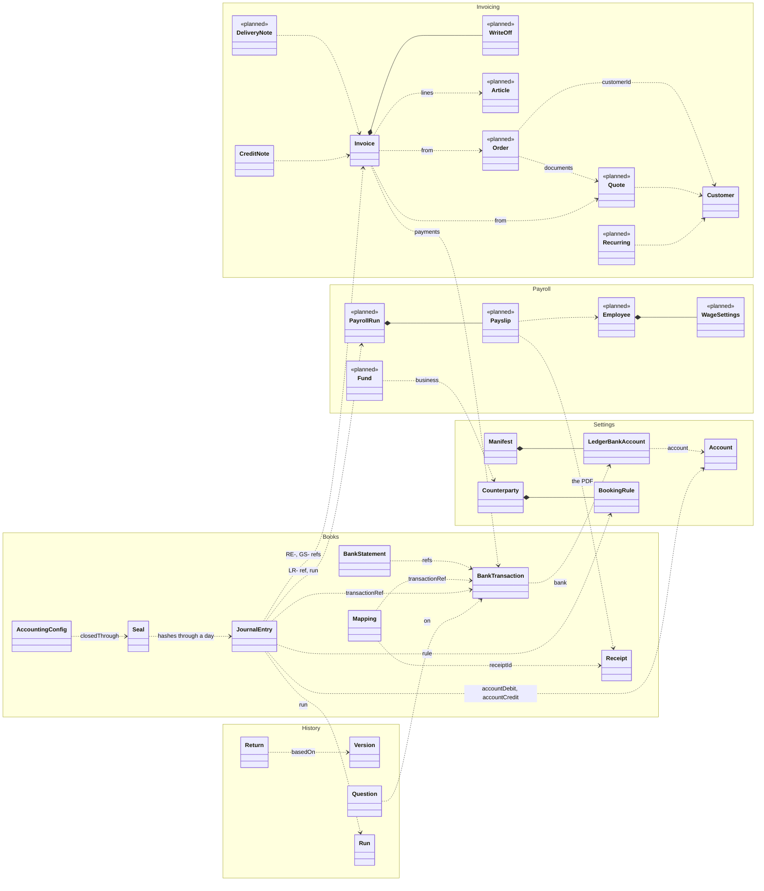
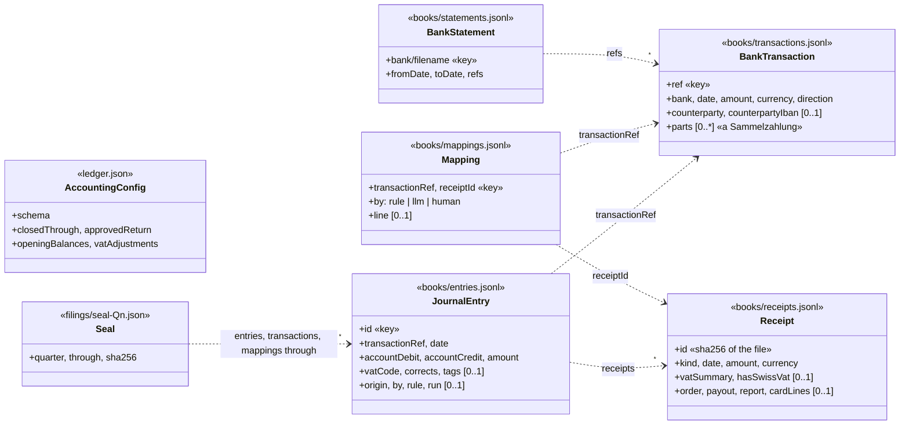
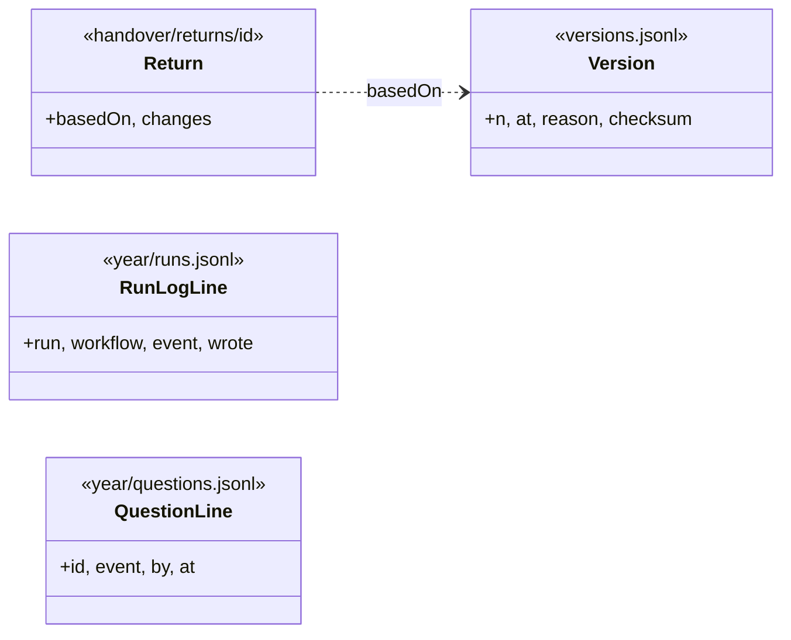

# Spec: the whole domain model

Status: draft for the owner, 2026-11-15. No code yet. Judged by [MISSION.md](../../MISSION.md),
[ADR 0004](../adr/0004-versions-and-record-envelope.md) (versions and the record envelope),
[ADR 0013](../adr/0013-workspace-layout-and-ownership.md) (workspace layout),
[ADR 0015](../adr/0015-base-cases-in-the-app-long-tail-in-the-workspace.md) (app and workspace)
and the owner's rules: warn, don't block; compliant, not stricter; base cases in the app, the long
tail in the workspace.

The owner asked on 2026-11-15: «can you also start designing the whole data model. where do we
store the whole domain model? and how do we store modifications to that domain model?»

This spec describes the model as it is today and as the invoicing and payroll specs plan it. It
keeps the architecture as it is: the stores, their versions and git as the history stay. Sections
1 to 3 are the model itself: what exists, what the invoicing and payroll specs add, and one picture
of the whole. Section 4 says where the definition and its history live today. Section 5 sets how a
setting that changes over time is kept, which the invoicing and payroll specs rely on.

Changing the architecture (a common base object for every record, a version per record type, an
append-only change log, storage beyond git) is its own project: [#552](https://github.com/VanillaSystems/vanilla-accounting/issues/552).

## Summary

| Question | Answer |
|---|---|
| What the app stores | Section 1: every file, its owner module, its version and who writes it. |
| What the feature specs add | Section 2: invoicing (quotes, delivery notes, write-offs, recurring invoices, articles), payroll (employees, wage settings, funds, runs), and orders from outside in a store of their own per year. |
| Where the definition lives | As today: the TypeScript types and their TSDoc are the source, src/workspace/schema.ts holds the versions and their ladders, docs/data-model.md the diagrams (section 4). |
| How changes are stored | As today: state files are the truth, written through the write door; the records' own `origin`, `by` and envelope fields say who made the current state; git («Speichern») is the history (section 4). |
| Values that change over time | Every setting a document or run reads for its day is a dated history (`Dated<T>`: `validFrom`, optional `validUntil`, never overwritten), stored inline in its file. Documents and runs read on their own date and keep what they used. A change dated in the past warns and offers the ways on; the person decides (section 5). |

## 1. Inventory: what the app stores today

Every row is a file or a family of files the app reads. «Writes» names who changes it, through
which door. «Person» is a person in the UI or a command she runs (`PERSON`, actor kind `person`);
«AI» is the sidebar acting on her wish, which writes as the person and marks its bookings
`by.kind: 'assistant'`; «module» is code that writes on its own (`moduleActor(id)`); «run» is a
workflow run (actor kind `run`). Paths are relative to the workspace `vanilla-accounting/`.

### 1.1 The books

One `Index` in memory (`Books`, src/books/store.ts). `loadBooks` and `saveBooks` are the only door,
and every change goes through `update(books, actor, fn)`. One version for all of them:
`BOOKS_SCHEMA = 9`, ladder `BOOKS_MIGRATIONS` (src/workspace/schema.ts).

| Entity (code / UI) | File | Owner module | Writes |
|---|---|---|---|
| `JournalEntry` / Buchung | `transactional-data/<year>/books/entries.jsonl` | src/books/store.ts | module (classify, invoicing, year-close, sales-report), run, person, AI |
| `BankTransaction` / Zahlung, Bewegung | `…/books/transactions.jsonl` | src/books/store.ts | module (statement import), person (hand movement) |
| `Mapping` / Verknüpfung (receipt ↔ payment, or ↔ a booking's own ref; `line` for a card line) | `…/books/mappings.jsonl` | src/books/store.ts | module (match), run, person |
| `Receipt` / Beleg (with `OrderFacts`, `PayoutFacts`, `SalesReportFacts`, `CardLine`s, VAT facts) | `…/books/receipts.jsonl`; the file in `…/receipts/` | src/books/store.ts, src/intake/ | module (intake), run, person |
| `BankStatement` / Kontoauszug | `…/books/statements.jsonl`; the file in `…/bank-statements/<bank>/` | src/books/store.ts | module (import) |
| `StatementClosingBalance` / Saldo | `…/books/balances.jsonl` | src/books/store.ts | module (import) |
| `StatementAsk` (a PDF waiting for «Einlesen») | `…/books/asks.jsonl` | src/books/reconcile.ts | module, person |
| `Reconciliation` / Abstimmung | `…/books/reconcile.jsonl` | src/books/reconcile.ts | module, person |
| `AccountingConfig`: `closedThrough`, `approvedReturn`, `openingBalances`, `vatAdjustments`, … | `ledger.json` (with `schema`) | src/books/store.ts | person (filing, Firma › Eröffnung, Firma › MWST), module (year-close) |
| `Seal` / Siegel | `transactional-data/<year>/filings/seal-<Qn>.json` | src/books/seal.ts | person (`npm run seal`, the filing step); never rewritten |
| Filed returns (XML, PDF as filed) | `…/filings/` | src/workflows/filing.ts | person; never regenerated |
| Golden master of the books | `…/expected/` | tests/support/golden.ts | person (`npm run test:books:update`) |

Records of a year lie in the year of their date (src/books/years.ts). Records dated on or before
`closedThrough` are frozen and sealed.

### 1.2 Settings and master data

| Entity (code / UI) | File | Owner module | Version | Writes |
|---|---|---|---|---|
| `Manifest`: `Company`, `VatSetup`, `LedgerBankAccount`s, `Dimension`s, `InvoicingSettings`, `OutgoingMail`, `WorkspaceProfile` / Firma | `belege.workspace.yaml` | src/workspace/manifest.ts | `WORKSPACE_SCHEMA = 4`, `MANIFEST_MIGRATIONS` (on the YAML document) | person (Firma, `npm run init`), AI (draft, kept on a card) |
| Chart of accounts / Kontenplan | `master-data/accounts.json` | src/workspace/chart.ts | none | person, module (setup) |
| Mailboxes and sender sorting | `mail.yaml` | src/collect/mail-config.ts | none | person, AI |
| Sources (ADR 0014) / Quellen | `sources/` | src/platform/sources/load.ts | none | AI with the person |
| What a source delivered (dedup ledger) | `collected/<source>.jsonl` | src/platform/sources/ledger.ts | none | module (collect) |
| Secret terms for the leak guard | `secret-terms.txt` | src/publish/leak-guard.ts | none | person |
| Setup checklist / Einrichtung | `onboarding.json` | src/onboarding/store.ts | `SCHEMA = 1`, local, no ladder | module, person |
| Workspace overlays of modules and workflows | `modules/`, `workflows/` | src/core/modules/load.ts, src/workflows/ | the module's own version | AI with the person |

Each setting here is one current value, and a change overwrites it. Section 5 turns those a
document or run reads for its day into dated histories.

### 1.3 Knowledge

| Entity (code / UI) | File | Owner module | Version | Writes |
|---|---|---|---|---|
| `Counterparty` / Geschäftspartner (match signals, accounts, `provider:`, steps) | `processes/{suppliers,customers,authorities}/<id>.yaml` (app) + `knowledge/{…}/<id>.yaml` (company), merged | src/knowledge/counterparties.ts, layers.ts | none | app layer: maintainers; company layer: AI drafts, person keeps on a card |
| `BookingRule` / Regel (`when`, `then`) | `knowledge/rules/booking.guide.yaml#classify`, or a business's file | src/booking/rules.ts | none (refused when not executable) | AI or the hand form (src/saving/hand-rule.ts), person keeps |
| Guides and precedents per step | `processes/*.guide.yaml` + `knowledge/rules/*.guide.yaml` | src/knowledge/layers.ts | none | AI, person |
| Flows | `processes/*.flow.yaml` | src/workflows/ | none | maintainers |
| Notes / Notizen | the business's file | src/knowledge/notes.ts | none | person, AI |
| Tax codes, return forms, accounts, setup answers (law data) | `modules/ch/*.yaml` | src/core/modules/schema.ts, src/engines/ | `module.yaml` version (CalVer) | maintainers; a workspace overlay may replace an entry |

### 1.4 Invoicing

`invoices.json`, owner src/invoices/store.ts, `INVOICES_SCHEMA = 2`, ladder `INVOICES_MIGRATIONS`.
Records carry the ADR 0004 envelope (`id`, `createdAt`, `origin`, `deleted`).

| Entity (code / UI) | Where | Writes |
|---|---|---|
| `Customer` / Kunde | `invoices.json` `customers` | person, AI (draft) |
| `Draft`, `Issued` (an invoice or a credit note) / Rechnung, Gutschrift; with `InvoiceLine`s, `PaymentAllocation`s, `Reminder`s / Mahnungen, `Comment`s | `invoices.json` `invoices`; the PDF in `transactional-data/<year>/invoices/<number>.pdf` | person (only a person issues), module (invoicing: payments) |
| `SentDocument` / Versand | `invoices.json` `sent` | module, on a person's send |
| Logos | `logos/logo-<checksum>.<ext>` | person |
| Bookings of an invoice (`RE-…`, `GS-…`, `RE-…-storno`) | the books, `origin: 'invoice'` | module (invoicing) |

### 1.5 Logs and hand-over

| Entity (code / UI) | File | Owner module | Version | Writes |
|---|---|---|---|---|
| `QuestionLine` / Frage (asked, answered, undone, closed) | `transactional-data/<year>/questions.jsonl` | src/questions/ | `QUESTION_LINE_VERSION = 1` per line, no ladder | person, module, run, AI |
| `RunLogLine` / Lauf | `transactional-data/<year>/runs.jsonl` | src/workflows/runlog.ts | none | run |
| `Version` / Version («Version 12») | `versions.jsonl` | src/handover/versions.ts | `VERSIONS_SCHEMA = 1` (header line) | module, on a hand-over, a take-over, a seal |
| A return from the fiduciary / Rücksendung (the package and her decisions) | `handover/returns/<id>/` | src/handover/returns.ts | `PACKAGE_FORMAT = 1` | module on receipt, person on take-over |
| A package or share | encrypted at the share service, or a `.vanilla` file | src/handover/package.ts, src/share/ | `PACKAGE_FORMAT = 1`, `FORMAT_VERSION = 1` | module, on a person's share |
| Deleted bookings since the last save | `data/trash/entries/<id>.json` (not in git) | src/saving/changes.ts | none | module, on a person's delete |
| A prepared save | `data/saving/proposal.json` (not in git) | src/saving/saving.ts | none | module |

### 1.6 Outside the workspace

| What | Where | Why outside |
|---|---|---|
| Passwords, API keys, share keys, signing keys | the keychain or the desktop's sealed store (src/secrets/); `.env` as fallback | the workspace is a folder people share and commit |
| `DesktopState` (recent books, window, phone pairing; planned: this Mac's `person`) | `desktop.json` in the desktop's user data folder (src/desktop/state.ts) | belongs to the device, not the books |
| Reference data (ESTV daily rates, charts) | `reference/` of the app | public, the same for every company |

### 1.7 Reserved but not built

- `VERSION` at the top (LAYOUT, owner `app`): ADR 0004's one workspace version. Nothing writes it.
- `access.yaml` (people and roles, e2e spec Q-B1): planned, not built.

## 2. Planned entities

### 2.1 Invoicing (docs/specs/invoicing.md on `spec/invoicing`, decided 2026-11-14)

All in `invoices.json`, one `INVOICES_SCHEMA` step per phase (3 in phase 1, then one each in
phases 2 and 3), settings in the manifest's `invoicing:` (one `WORKSPACE_SCHEMA` step in phase 1).

| Entity (code / UI) | Shape | Booked |
|---|---|---|
| Quote / Offerte | `kind: 'quote'`, series `OF-YYYY-NNN`, `validUntil`, `status` draft → sent → accepted / declined / expired | nothing |
| Order confirmation / Auftragsbestätigung | the accepted quote sent again with that title; no record of its own | nothing |
| Delivery note / Lieferschein | `kind: 'delivery-note'`, series `LS-…`, no prices on paper | nothing |
| Invoice / Rechnung | gains `from: { id, kind }` (the quote or order), `ordered` (the customer's reference), `role: 'partial' \| 'final'`, `schedule` (instalments, retention), `offsets` (credit notes set off), `paidAtIssue` (Quittung) | as today; on the agreed basis `RE-<n>` |
| Credit note / Gutschrift | as today; set off as a deduction line (`InvoiceLine.deducts`) on the next invoice | as today |
| Write-off / Abschreibung, Skonto, Debitorenverlust | `writeOffs: [{ date, amount, reason, note }]` on an issued invoice | cash basis: nothing; agreed: `RE-<n>-wo-<k>` |
| Recurring invoice / Abo | `recurring: [Envelope & { customerId, template, every, next, until, issue }]` | as each invoice it makes |
| Article / Artikel | `articles: [Envelope & { number, text, unit, price: Dated, vatRate, account }]` | nothing |
| Line kinds | `InvoiceLine.kind` title, subtotal, text; `discount`, `articleId`, `activity`, `tags`, `source` | as the invoice |

### 2.2 Payroll (docs/specs/payroll.md on `spec/payroll`, decided 2026-11-14)

| Entity (code / UI) | File | Version |
|---|---|---|
| Payslip from outside / Lohnabrechnung (level A) | a `Receipt` of kind `payslip`; its figures derived on every read, not stored | `BOOKS_SCHEMA` 10 for `by.check: 'payslip' \| 'payrollJournal' \| 'payroll'` (one step) |
| Employee / Mitarbeiterin (name, AHV number, birth date, entry, exit, IBAN, language) | `payroll.json` `employees` | new `PAYROLL_SCHEMA = 1` |
| Wage settings / Lohnvereinbarung (dated contract entries: monthly or hourly, pensum, 13th salary, holidays; pension per employee; allowances; tax at source) | `payroll.json` `employees[].contract`, `pension`, `allowances`, `taxAtSource`, each `Dated` (section 5) | same |
| Funds and the firm's rates / Kassen und Sätze (canton, AHV fund, pension, accident, sickness, each entry with its source document) | `payroll.json` `plan`, each rate set `Dated` (section 5) | same |
| Payroll run / Lohnlauf, with its payslips and lines `{ kind, base, rate, amount, party, source }` | `transactional-data/<year>/payroll/runs.jsonl`, one released run per line, immutable; a correction is a new run with `corrects` | same |
| Payslip PDF of a run | a `Receipt` of kind `payslip` in `…/receipts/`, linked to the run | books |
| Bookings of a run | `LR-<yyyy>-<mm>-<employee>`, `by: { kind: 'code', check: 'payroll' }`, `run` | books |
| Federal rates and Lohnausweis fields | `modules/ch/payroll.yaml`, `modules/ch/payroll/<year>.yaml` | the module's version |

### 2.3 Orders from outside / Bestellung (new, design only)

An order is a customer's wish to buy, from outside the app: a form on the firm's website, a shop,
an e-mail a source turns into data. It is not a tax event: it books nothing. It leads to a
document the person sends (an order confirmation, a delivery note, an invoice), or it is the sale
of a payment provider that the provider's report books already.

```ts
interface Order extends Envelope {        // id, createdAt, origin: 'import' | 'manual', deleted
  source: string;                         // the source that delivered it (sources/<id>, ADR 0014)
  external: string;                       // its id at the source; (source, external) is unique
  date: string;                           // the order's date as the source states it
  customer: { name: string; email?: string; address?: Address; uid?: string; language?: string;
              customerId?: string };      // set once matched to a Customer, by code or by the person
  lines: Array<{ text: string; quantity: number; unit?: string; price: number; vatRate?: number;
                 vatIncluded?: boolean; articleId?: string; sku?: string }>;
  currency: string;
  total: number;                          // as the source states it; code checks it against the lines
  paid?: { provider: string; ref?: string; at: string };   // paid at the source (a provider's file id)
  status: 'received' | 'accepted' | 'declined' | 'done' | 'cancelled';
  documents?: string[];                   // the quote, delivery note or invoice ids made from it
  file: string;                           // the delivered file, kept beside the records
}
```

**Where it lands.** A source or a drop delivers one file per order into `beleg-import/`, in a
small versioned upload shape (`{"v":1,"kind":"order",…}`, like the receipt upload format). The
intake reads it, finds an earlier one by `(source, external)` and so never takes an order twice,
and writes the record to `transactional-data/<year>/orders/orders.jsonl` (year of `date`), the file
beside it. A new store with its own `ORDERS_SCHEMA = 1`; LAYOUT's year gains `orders`. Not
`invoices.json`: a shop has thousands of orders a year, and they belong to a year.

**What follows, by code first.** The customer is matched by e-mail or UID, or proposed as a new
`Customer`. An order with `paid` by a provider whose file has `reports.sales` is that provider's
sale: it links to the order page or the report row by its number and nothing more happens (no
second booking). Any other order proposes an order confirmation or an invoice draft; a person
issues it (invoicing decision 7.4). Only base cases in the app: a website's own fields are mapped
in the workspace's source, never in app code (ADR 0015).

`OrderFacts` on a receipt stays what it is: the facts read off a provider's order page. An `Order`
and an order page with the same number refer to the same sale.

## 3. The whole model

### 3.1 Glossary

The code name is English, the UI name German. One name per thing, in code, docs and UI.

| Code | UI (de) | What it is |
|---|---|---|
| Workspace | Buchhaltung, Bücher | One company's `vanilla-accounting/` folder |
| Manifest | Firma | Who the company is, its VAT setup, money accounts, settings |
| LedgerBankAccount | Geldkonto | A ledger account money moves through (bank, card, cash, owner) |
| Account (chart) | Konto, Kontenplan | An account of `master-data/accounts.json` |
| BankTransaction | Zahlung, Bewegung | One movement on one money account |
| BankStatement | Kontoauszug | A statement file and the movements it confirmed |
| StatementClosingBalance | Saldo | A balance a statement states |
| Reconciliation | Abstimmung | Read movements set against a bank export |
| Receipt | Beleg | A document: invoice, sales record, supporting, statement, payslip |
| Mapping | Verknüpfung | A receipt linked to a payment or to a booking |
| JournalEntry | Buchung | One debit/credit line, with its VAT code |
| AccountingConfig | – | `ledger.json`: the books' head |
| closedThrough | eingereicht bis | The line of the filed periods |
| Seal | Siegel | The hash of everything filed through a day |
| VatAdjustment | MWST-Korrektur | A VAT event of the open period on a filed entry |
| Counterparty | Geschäftspartner | A business with a file of its own |
| BookingRule | Regel | `when` → `then`, carried out by code |
| Question | Frage | A question between the people who keep the books |
| Run | Lauf | One workflow run over one item |
| Customer | Kunde | Who an invoice goes to |
| Invoice, CreditNote | Rechnung, Gutschrift | A document that asks for or returns money |
| Quote | Offerte | A price offered, before an order |
| DeliveryNote | Lieferschein | What was delivered, no prices |
| Reminder | Mahnung | A reminder of an overdue invoice |
| WriteOff | Abschreibung | What will not be paid: Skonto, discount, loss |
| Recurring | Abo | An invoice made again every period |
| Article | Artikel | A priced item to put on a line |
| Order | Bestellung | A customer's order from outside |
| Employee | Mitarbeiterin, Mitarbeiter | A person on the payroll, the owner included |
| WageSettings | Lohnvereinbarung | An employee's contract lines from a date |
| Fund | Kasse | AHV, pension, accident, sickness insurer, with the firm's rates |
| PayrollRun | Lohnlauf | One month's released payroll |
| Payslip | Lohnabrechnung | One employee's lines of a run, and its PDF |
| Version | Version | A named state of the books (hand-over, take-over, seal) |
| Return | Rücksendung | A fiduciary's changes, sent back |
| Dated (new) | gilt ab, Verlauf | A setting's values, each with the days it holds (section 5) |

### 3.2 The whole model in one picture

Only entities and their main references. The fields are in the per-area diagrams and in
[docs/data-model.md](../data-model.md). A dashed arrow is a reference by key. Planned entities are
marked `<<planned>>`.



### 3.3 The books



### 3.4 Invoicing and orders

```mermaid
classDiagram
  direction LR
  class Order {
    <<year/orders/orders.jsonl · planned>>
    +source, external «unique»
    +customer, lines, total, currency
    +paid [0..1], status
  }
  class Quote {
    <<invoices.json · planned>>
    +number «OF-YYYY-NNN»
    +validUntil, status
  }
  class Invoice {
    <<invoices.json>>
    +number «YYYY-NNN»
    +from [0..1], role [0..1]
    +schedule, offsets [0..*]
  }
  class DeliveryNote {
    <<invoices.json · planned>>
    +number «LS-…»
  }
  class CreditNote {
    <<invoices.json>>
    +number «YYYY-NNN»
  }
  class WriteOff {
    +date, amount, reason
  }
  class Customer {
    <<invoices.json>>
    +number [0..1], address, uid, language
  }
  class Recurring {
    <<invoices.json · planned>>
    +template, every, next
  }
  Order ..> Customer : customerId
  Order ..> "*" Quote : documents
  Quote ..> Customer
  Invoice ..> Quote : from «accepted: Auftragsbestätigung»
  Invoice ..> Order : from
  DeliveryNote ..> Invoice
  CreditNote ..> Invoice : credits or offsets
  Invoice *-- "*" WriteOff
  Recurring ..> Customer
  Recurring ..> "*" Invoice : makes
```

### 3.5 Payroll


### 3.6 History



## 4. Where the definition and its history live today

**The definition** is spread over a few places:

- **TypeScript types**: src/types/index.ts (the books), src/invoices/model.ts, src/workspace/workspace.ts
  and manifest.ts, src/questions/model.ts, src/handover/, src/core/modules/schema.ts (law data).
  This is what the code obeys. The TSDoc comments hold most of the rules.
- **src/workspace/schema.ts**: the versions of the books, the manifest and `invoices.json`, each
  with a forward-only, pure ladder run in memory on every load; `npm run update` writes the result
  back after a backup. A file newer than the app is refused (`SchemaTooNewError`). Most books steps
  change nothing on purpose: the number only makes an older app refuse books with a field it would
  mishandle. A books step never changes a sealed record. `onboarding.json`, `questions.jsonl`,
  `versions.jsonl` and the package keep their versions elsewhere, without a ladder.
- **docs/data-model.md**: Mermaid diagrams written by hand. It describes branch 0.4.0 and has
  drifted: it shows the manifest at `schema = 3` (the code is at 4) and `invoices.json` at 1 (the
  code is at 2). Section 3 of this spec can replace its overview.
- **ADRs and specs**: why a shape is as it is. docs/releasing.md: a schema bump is MINOR (MAJOR
  when the adopter must act).
- **Hand-written parsers** (`parseManifest`, `parseCustomer`, the books' loaders) check at the
  boundary, with German messages. Knowledge files (YAML the AI writes) have no version; the code
  that reads them checks their shape (src/booking/rules.ts refuses a rule it cannot carry out).

**Changes of the data:**

- **State files are the truth.** Every write is a whole-file atomic write through the write door
  (`update`, `saveBooks`; invoices through src/invoices/store.ts). `StaleBooksError` refuses a save
  over files another process wrote.
- **Who, on the record.** An entry carries `origin` and `by` (rule, code check, model, person with
  `at` and `was`, the AI sidebar with its conversation), `run`, `rule`. A link carries `by`, `rule`
  and `run`. Invoice records carry the ADR 0004 envelope.
- **Git is the history.** «Speichern» in Änderungen commits a prepared save (src/saving/saving.ts),
  with trailers (`Vanilla-Kind`, `Vanilla-Run`, `Vanilla-Person`). Between two saves the app shows
  what changed by diffing against the last commit (`handEdits`, `recordChanges`). Deletions wait in
  `data/trash/entries/` until the next save.
- **Logs** of their own: `questions.jsonl`, `runs.jsonl`, `versions.jsonl`, `collected/<source>.jsonl`.
- **Seals** prove that nothing dated through a filed day changed. **Returns** from the fiduciary
  carry record changes (src/handover/records.ts) and are taken over by record, three ways.

A generated schema with a drift test, versions per record type and a change log per action are
in [#552](https://github.com/VanillaSystems/vanilla-accounting/issues/552).

## 5. Values that change over time («gilt ab»)

The owner asked on 2026-11-15: «are we also taking change into consideration? all of those fees
and everything, they can be changed, right? So a Lohn can be changed, a Beitrag can be changed».

Today only law data changes by date: `modules/ch/payroll/<year>.yaml` (one file per year, rows
`{ value, source, validFrom }`) and the VAT rates of `modules/ch/rates.yaml` (`superseded`). The
firm's own settings are single current values: a wage, a fund's rate, an article's price, a
customer's terms, the firm's address and IBAN. A change overwrites the old value, and nothing
can tell what held on an earlier day. `company.vat.reportingSince` is the one exception, and it
is a dated history in all but name.

This section sets one rule for every store. The invoicing and payroll specs apply it (invoicing
4.12, payroll §16).

### 5.1 The rule

1. **A setting that can change is a dated history.** This applies to every value that a
   document, a run or a booking reads for its own day. Each entry says from when it holds
   (`validFrom`) and, optionally, until when (`validUntil`). A change is a new entry, whether it
   is dated today, in the past or in the future («gilt ab»). An entry is never overwritten.
2. **The value on day D** is the entry with the latest `validFrom` on or before D. Two entries
   with the same `validFrom` are decided by the later `enteredAt`. If that entry's `validUntil`
   lies before D, there is no value on D. A missing value is a fact («kein Vertrag ab
   01.04.2026»), never a guess, and the reader treats it as a missing input (a line
   «unvollständig», a base error).
3. **Documents and runs read on their own date, and keep what they used.** An invoice reads on
   its date. A run over a period reads every entry that holds within the period (payroll splits
   a month by days, payroll §16). What a document or run used is copied into it when it is issued
   or released, so a later change never alters it.
4. **A change dated before something already issued or released warns.** Code finds every
   issued document and released run that used another value for a day the change now covers.
   It names them («Für September freigegeben mit 7.5 %; ab 01.09.2026 gilt jetzt 7.8 %») and
   offers the area's ways on (payroll: reopen the run, or the difference in the next run;
   invoicing: a supplementary invoice or a credit note as a draft). It also offers «So lassen».
   The person decides. There is no override flag, and a filed period stays as filed (golden
   rule 1).

### 5.2 The shape

One generic type, in the app's core (no jurisdiction in it):

```ts
/** One value and the days it holds. Days are YYYY-MM-DD, both ends inclusive. */
interface DatedEntry<T> {
  validFrom: string;
  /** Absent: until the next entry begins, or open-ended. Set for an end with nothing after it (an exit, an allowance that stops). */
  validUntil?: string;
  value: T;
  /** When it was entered (ISO time). Decides between two entries of the same validFrom. */
  enteredAt: string;
  /** The document the value was read from: a pension certificate, a policy, a price list. */
  source?: { receiptId?: string; note?: string };
}
/** Sorted by validFrom, then enteredAt. An entry is addressed by (validFrom, enteredAt). */
type Dated<T> = readonly DatedEntry<T>[];
```

- **One history per thing that changes together.** Whatever one document sets is one entry with
  an object value. A fund's Beitragsverfügung sets `{ adminCost, fak }`, a contract sets
  `{ kind, amount, pensum, thirteenth, holidayWeeks }`, an address is one value. Things that
  change independently get histories of their own (an employee's IBAN beside the contract).
- **The reader** is one module, `src/core/dated.ts`: `valueOn(h, day)`, `entriesWithin(h, from,
  to)` (a run's month), `current(h, today)`, `planned(h, today)` (entries after today), and
  `addEntry(h, entry)`, the only writer. `addEntry` appends and sorts. It refuses only a
  malformed day or a `validUntil` before `validFrom`. Overlaps are not an error, because the
  latest `validFrom` decides.
- **The type makes the old read fail.** A `Dated<number>` is not a `number`, so every place that
  read the single value stops compiling once the field becomes a history. Each reader must name
  its day. That makes the change of the type the to-do list of the migration.
- **Withdrawing.** An entry that no document or run has used yet can be removed (a planned raise
  that is dropped). Code checks that no copy names it. An entry that was used stays. A wrong
  value is corrected by a new entry with the same `validFrom`, which wins by `enteredAt`. Both
  stay in the list.
- **Law data takes the same shape.** The VAT rates of `modules/ch/rates.yaml` gain `validFrom` and
  `validUntil` in place of `superseded`, and the federal payroll rows already have `validFrom`.
  The same `valueOn` reads them, so the app has one way of saying «valid on D». They stay app
  data with their sources, maintained with each release.

### 5.3 Where it is stored

Inline, in the file that holds the setting: the field holds its list instead of one value. There
is no separate history file. A history lives and travels with its record, it is merged by the
record like any other field (returns, src/handover/records.ts), and git shows each added entry as
a few added lines.

| Store | Dated fields (the specs name each one) | Not dated, and why |
|---|---|---|
| `belege.workspace.yaml` (Firma) | name and address of the firm, `payTo` per currency (IBAN, QR-IBAN), `company.vat` (with yearly `validFrom`; `reportingSince` folds into it), the invoicing defaults (payment term, Skonto, dunning levels and fees, interest), the account choices (revenue, fees, write-offs) | layout, texts, number patterns, mail and sources: an issued document keeps its own copy, and nothing reads them for a past day |
| `invoices.json` | a customer's address, terms, discount, revenue account; an article's price | a customer's number and language; an article's number and text (a new text is a new article, or simply a line typed by hand) |
| `payroll.json` | an employee's contract, pension figures, allowances, tax at source, address, IBAN; the firm's plan (canton, each fund's and insurer's rates, VAV) | birth date and AHV number (one per life); entry and exit, which are derived from the contract's history |
| `master-data/accounts.json`, knowledge, rules | none | a booking keeps the account it used, and a rule acts when it runs; an entry it booked stands |

A dated field in YAML reads like this:

```yaml
company:
  address:
    - validFrom: 2024-01-01
      enteredAt: 2024-01-03T09:12:00+01:00
      value: { street: Musterweg 1, zip: "3000", town: Bern, country: CH }
    - validFrom: 2026-12-01
      enteredAt: 2026-11-15T10:02:11+01:00
      value: { street: Beispielstrasse 4, zip: "3011", town: Bern, country: CH }
```

### 5.4 What a document or run keeps

A document or run copies the values it used when it is issued or released. It does not copy the
whole history.

- **Issued invoice, credit note, reminder.** It keeps its lines with prices and rates, the
  customer (address, terms), the sender (name, address, UID, `payTo`), the layout and the PDF
  with its SHA-256. Most of this exists today (`Issued.customer`, `Issued.sender`,
  `Issued.layout` in src/invoices/model.ts). The terms (due date, Skonto) join it.
- **Released payroll run.** Each line keeps base, rate and source (exists). The run gains
  `used: Array<{ path; validFrom; enteredAt }>`, which names each dated entry it read. With it,
  code can tell exactly which runs a later change touches.
- **A booking** is its own copy: account, code and amount are on the entry.

A draft copies nothing yet. It reads the values on its date, and again whenever that date
changes.

### 5.5 A change dated in the past

When a new entry is saved, code compares it with every copy (5.4) whose day it now covers:

- **No copy differs:** the entry is saved, and the next draft or run reads it.
- **A copy differs:** before the save, the card names each document or run, what it used, and what
  holds now, and offers the area's ways on (5.1, point 4). The choice is an ordinary action: a
  reopening, a correction line in the next run, a draft of a supplementary invoice, or nothing.
  The entry itself carries no mark of the warning.
- **«So lassen»** leaves a fact on the document or run, never a reminder: «berechnet mit 7.5 %;
  seit 15.11.2026 gilt für September 7.8 %». The person can act on it later from there.
- **A filed or sealed period** never changes. A correction is dated in the open period (payroll:
  the correction run; invoicing: the credit note or the supplementary invoice), with `corrects`
  where golden rule 1 asks for it.

### 5.6 UI and the AI

- **One field component for every dated setting.** It shows the current value with «ab
  TT.MM.JJJJ», a planned entry below it («ab 01.01.2027: 9'500, geplant»), and a small fold
  «Verlauf» with the earlier entries, each with its source document. No history screen of its
  own.
- **«Ändern»** asks for the new value and «gilt ab». The default is today. Payroll uses the first
  day of the first month without a released run. A date that reaches a copy shows the warning of
  5.5 on the same card, before anything is saved.
- **The AI sidebar** proposes `{ path, value, validFrom }` («Mein Lohn ab Januar 9'000» → the
  contract from 01.01.2027 with the amount 9'000). Code checks the proposal, writes the entry
  through `addEntry`, and shows it on a card with the old and the new value. The person keeps the
  card. Without the AI, the same form does the same.

### 5.7 Migration, and who entered an entry

- **One ladder step per store** that changes a single value into a history. The step writes
  `[{ validFrom: <first day of the books>, enteredAt: <the step's time>, value }]`. The first day
  of the books is the first day of the earliest year under `transactional-data/`. The step is
  pure, and an older app refuses the file, because the meaning of the field changed. The manifest
  takes it in its next step (`WORKSPACE_SCHEMA` 5) and `invoices.json` in the step of invoicing
  phase 1. `payroll.json` starts with histories at 1, so it needs no step. `company.vat.reportingSince`
  becomes the first entry of the VAT setup's history.
- **The history models the value; who entered it comes from what exists.** `enteredAt` is on the
  entry. Who entered it is what the app knows today: the actor fields of the record that holds
  it, where it has them (`origin`, `by`, the invoices' envelope), and the commit of the save that
  added it («Speichern», trailer `Vanilla-Person`). Adding an entry needs no new log. A reopening
  or a correction that follows a warning is an action of its own.
- **docs/data-model.md** shows a dated field as `«dated»`.

## 6. Open question for the owner

Pre-decided; a plain «ok» accepts it. Section 5 answers the owner's own question and asks nothing.

1. **Orders (section 2.3): a store of their own per year (`orders/orders.jsonl`), not
   `invoices.json`?** *Recommendation:* yes. A shop's orders are many and belong to a year; an
   order books nothing until a document or a provider's report does.

## Sources

- Code: src/types/index.ts, src/workspace/schema.ts, src/workspace/workspace.ts (`LAYOUT`),
  src/books/store.ts (`update`, actors), src/books/years.ts, src/books/seal.ts,
  src/handover/versions.ts, src/handover/records.ts, src/handover/returns.ts,
  src/saving/changes.ts, src/saving/saving.ts, src/invoices/model.ts, src/onboarding/store.ts,
  src/questions/model.ts, src/workflows/runlog.ts, src/platform/sources/ledger.ts,
  src/secrets/secrets.ts, src/desktop/state.ts.
- Docs: [docs/data-model.md](../data-model.md), [docs/releasing.md](../releasing.md),
  [ADR 0004](../adr/0004-versions-and-record-envelope.md), [ADR 0010](../adr/0010-invoicing.md),
  [ADR 0011](../adr/0011-payroll.md), [ADR 0013](../adr/0013-workspace-layout-and-ownership.md),
  [ADR 0015](../adr/0015-base-cases-in-the-app-long-tail-in-the-workspace.md),
  [docs/specs/e2e-and-fiduciary.md](e2e-and-fiduciary.md) (Q-B1), docs/specs/invoicing.md
  (branch `spec/invoicing`, 4.3, 4.5, 4.12, 7), docs/specs/payroll.md (branch `spec/payroll`, 5.3,
  6.5, 7, 13, 16).
